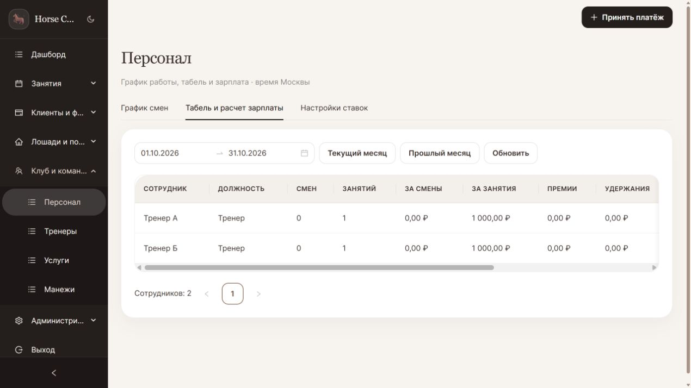
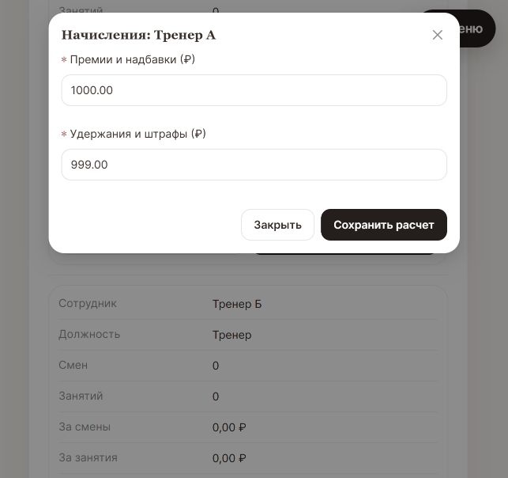

# Аудит Horse Club CRM — 19 октября 2026 года

Проверены доступный исходный код, схема данных, миграции, автоматические проверки и отдельные пользовательские сценарии на искусственных данных. Основа проверки — коммит `3a91a517f6a9e09f6ed524bd3b91fe23eaf4fe6f` и наблюдавшиеся изменения рабочего дерева. Это технический аудит и правовой анализ выявленных механизмов, а не заключение о законности всей деятельности ООО.

## 1. Основной вывод

**Система содержит существенную работающую основу, но пока не готова к использованию как единственный источник расчета зарплаты и учета денежных операций. Готовность к продаже как сервиса для нескольких независимых клубов также не подтверждена.** Ограниченный пилот с отдельной базой, сверкой бухгалтером и предварительным устранением ошибок возможен.

Реализованные экраны, таблицы и успешные тесты нельзя приравнивать к корректности всех бизнес-сценариев. Проверка на PostgreSQL воспроизвела пропуск занятия при начислении, повторную оплату одного занятия после перепривязки тренера и удаление оплаченной записи через прежний платежный механизм. Поле «штрафы» допускает произвольное вычитание почти всего начисления без основания.

В ходе аудита в той же папке параллельно менялись права доступа, роли, интерфейс и тесты. Поэтому результаты ниже относятся к конкретным запускам, а не ко всем будущим изменениям. Код приложения в рамках этого аудита не исправлялся. Добавлены отчет, журналы и два сценария воспроизведения. Изменения других работ не откатывались.

## 2. Что действительно сделано

В модуле персонала имеются профили, ставки, смены и статусы, календарь, расчет за период, премии/удержания, сохранение ведомости, выплата с созданием расхода SALARY и разграничение собственных/чужих данных на уровне сервиса. Расчеты используют Decimal; выплата выполняется транзакционно, с Serializable, повтором конфликтов и блокировкой сотрудника. Повторная отправка той же выплаты защищена при неизменных параметрах. Оплаченные пересекающиеся периоды одного сотрудника блокируются. Это полезные и проверяемые механизмы.

В остальных частях проекта имеются учет клиентов и абонементов, расписание, лошади, постой, ветеринарные записи, касса, публичный сайт и VK-интеграция. Проверялись общие ограничения, связанные с деньгами, доступом, данными и эксплуатацией; исчерпывающий ручной прогон каждой комбинации всех этих модулей не выполнен.

Сопоставление с приложенным заданием:

| Требование | Оценка |
|---|---|
| Модели профилей, смен, ведомостей | Реализованы; сами по себе не образуют юридически полный кадровый учет |
| Смены, завершение, период, ставки | Реализованы; ночная смена через полночь запрещается текущей проверкой времени |
| Начисления по завершенным Lesson | Реализованы в буквальном соответствии с указанной сущностью; другие занятия Booking пропускаются |
| SALARY и атомарность выплаты | Реализованы и отдельно проверены на PostgreSQL |
| Запрет чужих ставок/начислений | Проверен для тренера; новая конфигурация модулей во время аудита дополнительно запретила ему весь раздел |
| Личный график сотрудника | Нужно проверить с окончательными настройками модулей: текущий 403 не подтверждает выполнение исходного требования |
| Сборки и проверки без ошибок | Не достигнуто на последнем сохраненном запуске backend; полный актуальный E2E не завершен |
| Полноценный табель и законная зарплата | Задание этого не обеспечивало; необходим отдельный учет факта времени и обязательных начислений |

## 3. Воспроизведенные существенные дефекты

### PAY-01 — отдельные проведенные занятия не попадают в зарплату. Высокий приоритет

`backend/src/staff/staff.service.ts`, метод `compute`: запрос выполняется только к `Lesson`, связанной через текущий `trainerId`. В расписании существует и самостоятельная `Booking` без `lessonId`.

На искусственных данных создана одна завершенная самостоятельная Booking со ставкой тренера 1 000 ₽. Результат: **0 занятий, 0 ₽**. Начисление зависит от способа создания записи в расписании. В исходном задании прямо указана Lesson, поэтому это прежде всего неполнота интеграции с фактической моделью продукта, а не ошибка арифметики.

Исправление: определить единый оплачиваемый факт занятия и правила групповых занятий, отмен, замен тренера и абонементов; избежать двойного учета Lesson и ее участников. Проверить одинаковый результат для обоих способов записи.

### PAY-02 — одно занятие можно оплатить двум сотрудникам. Высокий приоритет

`staff.service.ts`: `compute`, `unlocked`, `payout`; `backend/src/users/users.service.ts`: `setTrainer`.

Воспроизведение: одно завершенное Lesson → начисление и выплата сотруднику А 1 000 ₽ → снять с его учетной записи привязку тренера → назначить того же тренера сотруднику Б → рассчитать и выплатить тот же период. Итог: **одно занятие, два расхода SALARY, всего 2 000 ₽**.

Блокировка относится к `staffId`, а источник начисления определяется изменяемой связью пользователя с тренером. Историческое право на оплату источника не закреплено. Это не обход через анонимный доступ: необходимы управленческие права, но обычная административная перепривязка не должна менять уже оплаченную историю.

Исправление: хранить исполнителя и строки начисления с идентификаторами первичных событий; фиксировать историю замен/привязок; ограничивать повторное включение оплаченного события. Проверять исправления отдельными корректировочными документами.

### CASH-01 — прежний платежный API позволяет удалить оплаченную запись. Высокий приоритет

`backend/src/payments/payments.service.ts`: `create`, `update`, `remove`; соответствующий контроллер разрешает операции административным ролям.

Через прежний механизм создается Payment со статусом PAID и без `cashierId`. Проверка запрета редактирования/удаления ориентируется на наличие кассира. Такая оплаченная запись **физически удаляется**. Воспроизведено сервисным сценарием на PostgreSQL; контроль роли установлен чтением контроллера. Это не утверждение о возможности удаления любого нового платежа кассы.

Исправление: единые правила неизменности проведенных денежных операций для всех точек входа; сторно/возврат вместо удаления; автор, основание, связь с исходной записью и журнал действий. Старые маршруты закрыть или привести к тем же правилам.

### LAW-01 — произвольные «штрафы» без основания. Высокий приоритет

`staff.service.ts`: `payrollAmounts`, `savePayroll`; форма персонала. Система приняла начисление 1 000 ₽ и удержание 999 ₽: **итог к выплате 1 ₽**. Основание, документ, тип удержания и применимый предел не запрашиваются.

Это подтверждает отсутствие защитных ограничений, но не доказывает, что клуб уже незаконно удерживал деньги. Денежный штраф как произвольное дисциплинарное взыскание для работника не входит в общий перечень ТК. Законные удержания и изменение премии — разные механизмы, с разными основаниями и пределами; простого переименования поля недостаточно. Общий предел удержаний имеет исключения, поэтому универсальная проверка «всегда не более 20%» тоже неверна. [ТК РФ, ст. 192](https://www.consultant.ru/document/cons_doc_LAW_34683/3a3bad3e8cac339021393236fd85d5a46a357735/), [ст. 138](https://www.consultant.ru/document/cons_doc_LAW_34683/32bc8a874b61cdf14efa68cbaff3c644e05ea597/).

Исправление: разделить трудовые начисления, законные удержания и договорные расчеты с подрядчиками; хранить основания и документы. До этого не использовать поле для фактических дисциплинарных штрафов работникам.

### CASH-02 — выплата наличных без наличных в учете. Средний приоритет

Выплата 1 000 ₽ прошла без поступлений и начального остатка: расчетный наличный баланс стал **−1 000 ₽**. После повторной выплаты из PAY-02 — −2 000 ₽.

Отрицательный остаток сам по себе не доказывает нарушение закона: возможно, не введен начальный остаток или не занесен приход. Но система не различает неполный учет и фактическую нехватку денег. Нужны начальные остатки, сверка, ясные ограничения проведения и связь с кассовой сменой. Если расход проводится только постфактум, это должно быть явно указано в интерфейсе.

### AUTH-01 — отключение профиля персонала не блокирует вход. Средний приоритет

После `StaffProfile.isActive=false` свежая авторизация по прежнему паролю успешна — HTTP 200. Флаг используется для планирования, а не как блокировка User. На новом варианте прав доступ к разделу персонала уже HTTP 403, но **сама учетная запись продолжает работать**. Это пробел процедуры увольнения/прекращения доступа, а не взлом авторизации.

Нужны отдельная блокировка учетной записи, отзыв действующих сеансов и инструкция отключения доступа. Нельзя считать действие «неактивный сотрудник» достаточным без этого.

### UPLOAD-01 — слабая проверка изображений и публичное хранение. Средний приоритет

Авторизованный TRAINER загрузил файл, состоящий только из восьми байтов сигнатуры PNG: HTTP 201. Затем файл получен без авторизации: HTTP 200. Искусственный файл после проверки удален.

`backend/src/upload/upload.controller.ts`: авторизация есть, но нет предметного ограничения роли/квоты; сигнатура не подтверждает корректность полного изображения. Нужны декодирование и безопасное повторное кодирование, ограничения размеров/квоты, жизненный цикл удаления, разделение публичных изображений и закрытых вложений. XSS или исполнение произвольного кода этим тестом **не доказаны**.

Доказательства: [reproductions.json](./reproductions.json), [reproduction-final.log](./reproduction-final.log), [http-reproductions.json](./http-reproductions.json). Повторный HTTP-тест с новым модульным доступом подтвердил вход неактивного сотрудника, запрет чужих данных и слабую проверку загрузки.

## 4. Другие обнаруженные ограничения

Эти пункты подтверждены чтением кода/схемы, но не все воспроизведены отдельным интеграционным тестом:

1. **Нет истории действия ставок.** Неоплаченный старый период считается по текущему профилю. Изменение ставки может ретроспективно изменить начисления. Нужны даты действия тарифов, основание и сохранение исходных строк расчета.
2. **Нет полноценного исправления оплаченной зарплаты.** Блокировка защищает от повторов, но требуется регламент доплаты, сторно и исправления источников после выплаты.
3. **Несогласованность оплаты и завершения Booking.** В `booking-lifecycle.service.ts` изменение оплачиваемого статуса при наличии денежного PAID-платежа отклоняется, а основной сценарий ориентирован на абонемент. Нужно проверить путь отдельного занятия, оплаченного наличными, от записи до завершения и начисления тренеру.
4. **Вызов API скрывает телефон, VK-уведомление может его отправлять.** `vk-training-notifications.ts` передает имена/телефоны клиентов тренеру. Политика минимального доступа должна действовать во всех каналах. Правомерность конкретной передачи зависит от целей, оснований и получателей; незаконность всех уведомлений не установлена.
5. **Резервирование неполное.** Имеются скрипты резервирования БД, ограничение доступа и ротация. Не подтверждено резервирование файлов uploads, внешняя защищенная копия и успешное восстановление всего продукта. Нужен проверенный сценарий восстановления БД вместе с файлами.
6. **Нет изоляции независимых клубов в общей БД.** В предметной схеме нет сквозного разделения по организации/арендатору. Отдельные установки с отдельными базами допустимы как модель поставки. Подключение нескольких независимых клиентов к одной общей базе требует отдельной архитектуры и проверки изоляции во всех запросах, отчетах, файлах и заданиях.
7. **Новая роль и настраиваемые модули менялись во время проверки.** Обнаруженное промежуточное отсутствие очистки данных для новой роли впоследствии было исправлено параллельной работой; оно не включено как действующий доказанный дефект. Окончательная матрица ролей требует повторного запуска на зафиксированной версии.

## 5. Правовая проверка: что требуется до эксплуатации

### Зарплата и табель

Нынешняя ведомость — расчет по внутренним правилам клуба. Она не обеспечивает сама по себе учет фактически отработанного времени, сверхурочных/ночных/праздничных часов, отпускных и больничных, применимых гарантий оплаты, удержание НДФЛ, страховые взносы, расчетные листки и установленные сроки выплат. Два статуса смен и число выходов не заменяют весь обязательный учет. Ночная смена сейчас также не поддерживается. [ТК РФ, ст. 91](https://www.consultant.ru/document/cons_doc_LAW_34683/bd14cccf0a1f074ef104e82522f7e2dea04d651f/), [разъяснения Минтруда об оплате труда](https://mintrud.gov.ru/ministry/programms/28), [ФНС: НДФЛ](https://www.nalog.gov.ru/rn77/taxation/taxes/ndfl/).

Можно вести CRM как источник данных для бухгалтера/учетной системы. Следует установить, сумма в CRM начисленная или фактически выдаваемая после налогов, исключить смешение трудовых и подрядных расчетов. Нельзя утверждать, что любой ежемесячный выбор периода незаконен: система допускает произвольные даты; проблема в отсутствии контроля обязательных правил.

Запись расхода SALARY и `isPaid=true` не подтверждают реальную отправку денег банком, получение наличных работником или оформление подписанного первичного документа. Безналичная выплата сейчас является записью учета, а не банковской интеграцией.

### Касса и чеки

Внутренняя «Касса» CRM не является онлайн-кассой и не заменяет фискальный чек. Для расчетов с клиентами требуется определить применимость 54-ФЗ и исключений; допустима отдельная законно применяемая ККТ вне CRM. Собственная интеграция с ОФД не обязательна для существования CRM, но нельзя позиционировать текущий экран как полноценную фискализацию. Выплата зарплаты сама по себе не требует такого же чека продажи услуги. [ФНС: применение ККТ](https://www.nalog.gov.ru/create_business/ul/in_progress/kkt/), [ФНС о выплатах работникам и ККТ](https://www.nalog.gov.ru/rn45/news/activities_fts/13149915/).

Нужны сверка платежей, возвраты, первичные документы, права на проведение/отмену и неизменяемая история. Обнаруженный CASH-01 особенно важен для достоверности учета.

### Персональные данные

В репозитории недостаточно доказательств, чтобы признать обработку полностью соответствующей 152-ФЗ. Проверка должна включить фактического оператора, уведомление Роскомнадзора и его актуальность, цели/основания, поручения обработчикам, реальные места размещения БД и резервных копий, организационные меры и порядок реагирования. Наличие текста политики не подтверждает выполнение этих обязанностей. [152-ФЗ](https://www.consultant.ru/document/cons_doc_LAW_61801/).

| Область | Найдено и что сделать |
|---|---|
| Локализация | Проверка строки «Россия» в настройках сайта не проверяет сервер. Нужны договор хостинга, инфраструктура БД, файлов и копий |
| Иностранные ресурсы | На сайте есть изображения `images.unsplash.com`, при этом политика заявляет отсутствие трансграничной передачи. Запрос изображения может передавать IP и сведения браузера иностранному сервису. Это требует фактической проверки и согласования архитектуры/текста политики; передача всей клиентской БД этим не доказана |
| Медицинские сведения | Запись медицинских заметок по умолчанию ограничена — это плюс. Включение флага не заменяет определение законного основания для специальных категорий данных и необходимых согласий |
| Дети | Есть услуги для детей, но не обнаружен полноценный учет представителя, его полномочий и соответствующих оснований обработки. Проверить реальные анкеты и договоры |
| Публичные карточки и фото | Публикация тренеров и фотографий требует проверить права на изображение и основания распространения данных. Обычное согласие на внутренний учет не универсальное разрешение на публикацию |
| Сроки и удаление | Нет подтвержденного полного процесса отзыва/обезличивания по целям и срокам. Финансовые документы нельзя просто удалять вместе с клиентом: необходимы разграничение целей хранения и ограничение доступа |
| VK и доступ разработчика | Определить, какие данные и кому передаются. Если разработчик обслуживает реальные данные по поручению клуба, закрепить поручение и меры защиты договором |

Для распространения персональных данных предусмотрено отдельное регулирование: [ст. 10.1 152-ФЗ](https://www.consultant.ru/document/cons_doc_LAW_61801/591acc70f577873c1ee54765eda110b7a0271eaf/). Подписанных согласий и прав на фотографии вне репозитория не проверяли; их отсутствие в коде не означает автоматически отсутствие у клуба.

### Отмена занятия и защита потребителя

Правила Booking предусматривают штрафную отмену менее чем за 12 часов и списание стоимости/единицы абонемента. Для потребительских договоров фиксированное списание только за отказ может конфликтовать с правом отказаться от услуги с оплатой фактически понесенных расходов. Нельзя объявить любой no-show незаконным без договора и обстоятельств, но автоматическое правило требует переработки с юристом и доказательствами расходов. [Закон о защите прав потребителей, ст. 32](https://legalacts.ru/doc/ZZPP/glava-iii/statja-32/).

### Лицензии и права на компоненты

Проверка lock-файлов не выявила зависимостей с явными AGPL/GPL/LGPL-маркерами. У четырех пакетов без лицензии в lock-метаданных проверены фактические файлы — MIT. Это не полная юридическая экспертиза всех транзитивных компонентов и ресурсов. Нужно подготовить перечень лицензий и необходимые уведомления, отдельно проверить фотографии, шрифты, тексты и чужие фрагменты. Отдельного подтвержденного пакета уведомлений для поставки не обнаружено. Нельзя на этом основании утверждать, что уже нарушены все лицензии.

## 6. Как оформить отношения с ООО клуба, сохранив продажу CRM

Исходные данные пользователя: вы не сотрудник и не участник ООО; готовы к ГПХ; хотите продавать CRM другим клубам.

**Оформить разработку по договору с ООО можно. Но оформлять исключительные права на весь продукт на клуб без отдельного решения о вашей коммерческой модели нецелесообразно.** Автором остается физическое лицо; правообладателем может быть другое лицо по надлежащему основанию. Использование программы клубом, оплата хостинга или наличие файлов на его компьютере сами по себе не решают вопрос передачи прав.

Для вашей ситуации предварительно подходит следующая конструкция:

1. Зафиксировать существующую CRM и ее состав на дату договора: код, версии, материалы, сторонние компоненты. Проверить вклад других авторов/подрядчиков. Нельзя обещать единоличные права, пока этот вопрос не выяснен.
2. Сохранить исключительные права на базовый продукт за вами либо позднее передать их вашей собственной компании по договору.
3. Предоставить ООО клуба простую неисключительную лицензию на использование CRM для согласованных нужд. Прописать способы использования, установку/сервер, пользователей, срок, территорию, оплату, обновления и границы поддержки. Право продавать продукт другим клиентам должно сохраняться за вами.
4. Для будущих доработок заключить договор с техническим заданием, сроками, приемкой, оплатой и прямым условием о правах на результат. Для заказа непосредственно автору учитывать конструкцию авторского заказа; не применять механически правило «все заказное всегда принадлежит заказчику».
5. Отдельно согласовать доступ к персональным данным, ответственность за инфраструктуру, выгрузку данных при прекращении договора и техническую поддержку.

Авторский заказ позволяет согласовать передачу исключительного права либо предоставление права использования. Выбор должен быть явным; прямая работа с автором имеет особенности по сравнению с заказом у компании. [ГК РФ, ст. 1288](https://www.consultant.ru/document/cons_doc_LAW_64629/8729a73d82e444f858aa833f74191fd5de2f508d/), [ст. 1296](https://www.consultant.ru/document/cons_doc_LAW_64629/e1a2a66199f94c314b8613a44d2abbad7203f7ee/), [ст. 1236](https://www.consultant.ru/document/cons_doc_LAW_64629/1e55b2c783fea90d228b43b1b447e0c04738a80d/).

ГПХ — название группы договоров, а не способ автоматически сохранить права или избежать налогов. Для разового договора с обычным физлицом у ООО возникают обязанности налогового агента и, в применимых случаях, по страховым взносам; бухгалтер должен определить режим по составу договора. Для самостоятельной деятельности можно рассмотреть НПД при соблюдении ограничений: без работников по трудовым договорам, лимит дохода 2,4 млн ₽ в год, базовая ставка при расчетах с организациями 6%. Для роста и условий отдельных конкурсов может потребоваться ИП или собственное ООО. [ФНС: НПД](https://npd.nalog.ru/).

Регистрация программы в Роспатенте возможна и может быть полезна как часть подтверждения прав, но не заменяет договоры и не является обязательной предпосылкой появления авторского права. Это также не то же самое, что включение в реестр российского ПО. [Роспатент: регистрация программ](https://rospatent.gov.ru/ru/stateservices/gosudarstvennaya-registraciya-programmy-dlya-elektronnyh-vychislitelnyh-mashin-ili-bazy-dannyh-i-vydacha-svidetelstv-o-gosudarstvennoy-registracii-programmy-dlya-elektronnyh-vychislitelnyh-mashin-ili-bazy-dannyh-ih-dublikatov).

Если заявителем на грант будет клуб, сначала проверить условия о правах на результаты, софинансировании и допустимости расходов на внешнего разработчика. Обязательства клуба перед грантодателем могут противоречить модели, в которой права полностью остаются у вас. Добавление ОКВЭД само по себе эту проблему не решает.

## 7. Гранты и субсидии: реальные направления, без обещаний

**Подходящий открытый конкурс с подтвержденным соответствием вашей ситуации на дату аудита не установлен.** Это не означает отсутствия поддержки. Общие страницы и прежние конкурсы нельзя выдавать за одобренное финансирование в 2026 году. Не установлены ИНН заявителя, возраст компании, выручка, реестр МСП, задолженность, бюджет и содержание заявки — без этого нельзя оценить допуск.

| Направление | Для кого и практическая оценка |
|---|---|
| «Мой бизнес» Тамбовской области | Первое обращение: проверить действующие региональные отборы, консультации, помощь с бизнес-планом и допустимость оплаты разработки/лицензии. Контакты: (4752) 55-97-40, info@mbis68.ru |
| Центр инноваций социальной сферы | Для клуба с реальной социальной деятельностью проверить условия признания социальным предприятием и связанные меры. ООО допустимо в принципе; конный спорт или занятия с детьми сами по себе статус не гарантируют |
| Фонд содействия инновациям, программа «Старт» | Потенциальное направление для самостоятельного технологического продукта. Нужны реальная новизна, исследовательская/техническая задача и соответствие конкретному положению. Обычная учетная CRM автоматически этому не соответствует. Действующее подходящее окно и условия не подтверждены; официальный сайт части документов был недоступен |
| Президентские гранты | Прямой заявитель — соответствующая требованиям НКО, а не коммерческое ООО клуба или разработчик. Реальный социальный проект с НКО рассматривается отдельно от коммерческой продажи CRM |
| Региональный микрозаем | Возможен как отдельный инструмент при соответствии условиям, но это возвратные деньги, не грант |

Источники: [«Мой бизнес» Тамбов: направления и контакты](https://xn---68-9cdulgg0aog6b.xn--p1ai/napravleniya/), [Центр инноваций социальной сферы](https://xn---68-9cdulgg0aog6b.xn--p1ai/napravleniya/czentr-innovaczij-soczialnoj-sferyi/informacziya-o-czentre.html), [условия социального предпринимательства, ст. 24.1 209-ФЗ](https://www.consultant.ru/document/cons_doc_LAW_52144/6bed0cbbebe3fbadde4ef8d6aea6c8ff7ff383ce/), [ФСИ «Старт» — проверять актуальное положение](https://fasie.ru/programs/programma-start/), [Фонд президентских грантов: требования](https://pgrants.ru/en/faq), [региональные микрозаймы](https://xn---68-9cdulgg0aog6b.xn--p1ai/napravleniya/fond-sodejstviya-kreditovaniyu/vyidacha-mikrozajmov.html).

Для заявки подготовить два отдельных описания: (а) цифровизация действующего клуба, где ООО покупает/лицензирует продукт; (б) создание продукта разработчика для рынка клубов. Для второго направления полезны пилот с клубом, подтвержденные потребности еще нескольких клиентов, конкурентное сравнение, бюджет, календарный план, правовая схема владения и измеримый результат. Не следует регистрировать НКО или передавать права клубу только ради неподтвержденной возможности гранта.

## 8. Проверки и их фактические результаты

| Проверка | Результат и границы |
|---|---|
| Backend, исходный запуск | 399 тестов: 383 успешно, 0 ошибок, 16 пропущено; сборка успешна |
| Backend, последний сохраненный полный запуск | 406 тестов: 387 успешно, 3 ошибки, 16 пропущено. Ошибки в тестах клиентов: `this.modules.forRole is not a function` и HTTP 500 вместо 200 после изменения модульных прав. Это не доказательство такого же сбоя рабочего сервера, но тестовая проверка не зеленая |
| Backend, последняя сохраненная сборка | Успешна. Промежуточная ошибка генерации Prisma во время параллельного изменения устранена последующим успешным запуском |
| PostgreSQL, персонал | Отдельный интеграционный тест успешен: атомарность/откат, повторы, приватность, cash/card |
| PostgreSQL, расходы | Отдельный интеграционный тест успешен: ограничения, идемпотентность, баланс, отмена |
| PostgreSQL, расширенный запуск через schema-only | 406 тестов: 393 успешно, 0 ошибок, 13 пропущено. Обычный запуск сначала уперся в отсутствие CREATE DATABASE; использована отдельная схема |
| Frontend, повторный запуск после изменений | Линтер успешен, 133 теста успешны, production-сборка успешна |
| Landing | Production-сборка успешна. В E2E наблюдались успешные результаты 29 сценариев, но процесс не завершился штатно и остановлен; полного успешного итогового прогона с exit 0 нет. Последовательный линтер в этой команде не подтвержден |
| Frontend, полный mock E2E | После параллельного изменения прав первые три сценария кассы завершились ошибками; запуск остановлен. Полный актуальный набор не пройден; новые запросы настроек требуют проверки тестовых подстановок |
| Независимые денежные сценарии аудита | Пять сценариев воспроизводят описанные проблемы; повторены после сборки. Тесты намеренно подтверждают дефекты, а не готовность продукта |
| HTTP-сценарии аудита | Свежий вход неактивного сотрудника 200; доступ к разделу теперь 403; чужой профиль 403; неполное PNG принято 201 и прочитано анонимно 200 |
| Известные уязвимости production-зависимостей | npm audit --omit=dev: 0 для backend/frontend/landing на момент запроса. Это не проверка всех уязвимостей приложения и не аудит dev-инструментов |
| Статический аудит UI | Проектный JSX-aware strict-аудит: 0 замечаний. Это не подтверждение удобства всех экранов или полной доступности |

Успешные запуски на разных состояниях нельзя складывать в утверждение «все проверки последней версии пройдены». В проекте также есть пропущенные проверки, требующие внешней конфигурации. Полный сценарий реального банка, ККТ/ОФД, рабочего VK, восстановления production и проникновения в инфраструктуру не выполнялся.

## 9. Визуальные доказательства

Только искусственные сотрудники и суммы. Скриншот не заменяет результат проверки БД.





Файл `02-cash-desk.png` — неполный кадр: баланс находится вне видимой области. Он не используется как доказательство отрицательного остатка; доказательство — JSON и сценарий проверки.

## 10. Порядок доведения до готовности

1. Зафиксировать версию и завершить текущую переделку прав. Получить полный успешный итоговый прогон с неизменным кодом, включая собственный доступ сотрудника и отсутствие доступа к чужим данным.
2. Устранить PAY-01, PAY-02 и CASH-01. Добавить проверки именно на источники начисления, смену исполнителя и неизменяемость денежных операций.
3. С бухгалтером согласовать начислено/к выдаче, законные удержания, первичные документы, зарплатные сроки и сверку кассы. До этого проводить зарплату с независимой проверкой.
4. Согласовать с юристом трудовые/подрядные отношения, правила отмены, обработку медицинских/детских данных, публичные фото и поручение разработчику. Проверить реальное размещение и документы Роскомнадзора.
5. Ввести отключение учетных записей, квоты/валидацию файлов, защищенное резервирование и подтвержденное восстановление.
6. Закрепить права на CRM и лицензию клуба. Выбрать свой налоговый статус и модель поставки: отдельные установки либо сервис с доказанной изоляцией клиентов.
7. Провести ограниченный пилот с ручной сверкой, зафиксировать расхождения, только после этого обещать покупателям заявленную функциональность и уровень поддержки.
8. С готовой схемой прав, бюджетом и результатом пилота уточнять условия поддержки в Тамбове и конкретного конкурса ФСИ.

## 11. Границы правового вывода

Не проверены устав и реквизиты фактического ООО, договоры с персоналом и клиентами, согласия, ККТ и фактические чеки, бухгалтерские регистры, уведомления Роскомнадзора, реальный хостинг и резервные копии. Не обследованы территория клуба, земля и объекты, пожарная/производственная безопасность, содержание животных и ветеринарные документы; применимость образовательной или медицинской лицензии зависит от реально оказываемых услуг. Термин «иппотерапия» сам по себе не определяет правовой режим без анализа содержания услуги.

Поэтому утверждение «все без нарушений законодательства РФ» сейчас было бы недостоверным. Отчет определяет обнаруженные ошибки, правовые риски и необходимые доказательства, но не подменяет проверку этих документов и фактической деятельности.

## 12. Повторение технических доказательств

Аудиторские сценарии находятся в `backend/test/audit-20261019.cjs` и `audit-http-20261019.cjs`. Первый создает отдельную одноразовую схему PostgreSQL и удаляет ее после завершения; рабочие записи не используются. Локальный PostgreSQL доступен на 5432, тогда как обычная настройка проекта указывала другой порт. Секреты в отчет не выводились.

```powershell
# Из backend, после npm run build; только локальная тестовая БД.
$env:AUDIT_DB_PORT = '5432'
$env:AUDIT_SERVE = '0'
node test/audit-20261019.cjs
```

Для HTTP-проверки первый сценарий запускается с `AUDIT_SERVE=1` и удерживает отдельный тестовый сервер; второй сценарий применяется только к нему. После проверки команда `stop` в его терминале останавливает сервер и удаляет тестовую схему. Не применять искусственные пароли и этот сценарий на рабочем сервере.

Журналы и результаты находятся рядом с отчетом. `source-hashes.json` фиксирует хэши выбранных денежных сервисов в ходе проверки, а не всех файлов окончательного релиза.
