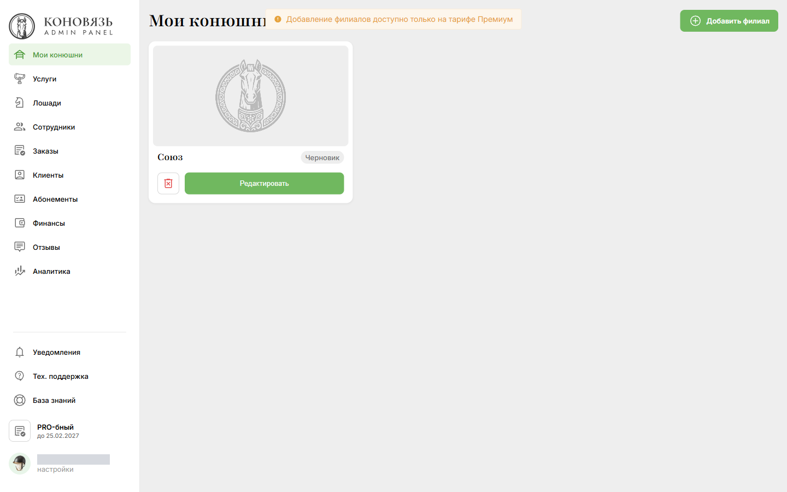
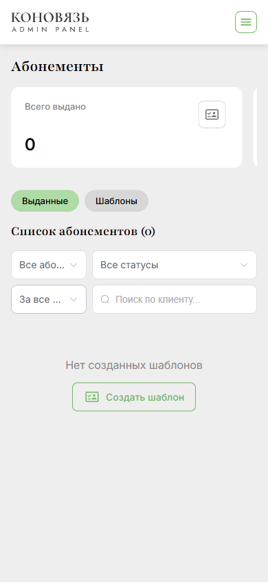

# Read-only аудит «Коновязь» и рекомендации для Horse Club CRM

Дата: **25 ноября 2026 года, Europe/Moscow**. Источник: авторизованная сессия `https://admin.konovyaz.ru` в Microsoft Edge, подключение Playwright `chromium.connectOverCDP('http://127.0.0.1:9222')`.

## Результат и границы достоверности

Обойдены все 13 пунктов основного меню, настройки и подписка. Сохранены **47 проверенных скриншотов**: 36 desktop 1440×900 и 11 mobile 390×844; **68 GET-ответов API** представлены обезличенными схемами в [network-schema.json](network-schema.json). Краткий протокол сессии — [session-summary.json](session-summary.json).

Главный полезный паттерн для нашего SaaS — отдельная компания, принадлежащие ей конюшни, активный контекст конюшни и тарифное право на филиалы. Главный пробел Horse Club CRM относительно этого паттерна — отсутствие моделей `Club`, `ClubSettings`, `ClubLicense` и сквозной tenant-изоляции в текущей Prisma-схеме. При этом наше приложение имеет существенно более глубокую реализованную модель финансов, постоя, ветеринарии и модульных прав, чем удалось наблюдать в доступном интерфейсе «Коновязи».

**Это полный обход доступной навигации, но не полная функциональная проверка продукта.** В учётной записи одна конюшня-черновик, одна лошадь, один сотрудник; нет клиентов, услуг, заказов, шаблонов и выданных абонементов, платежей. График клуба не заполнен. Текущий доступ — пробный PRO. Филиалы заблокированы тарифом. Нельзя подтвердить поведение наполненного расписания, выдачу и расходование абонемента, возвраты, выплаты и переключение между несколькими клубами. Для этого нельзя создавать данные в рамках данного задания.

Метки в отчёте:

- **Наблюдение** — видимый экран, открытая форма либо структура GET-ответа этой сессии.
- **Вывод** — интерпретация этих наблюдений, без доступа к внутренней архитектуре сервиса.
- **Рекомендация** — предложение для Horse Club CRM, а не утверждение о реализации конкурента.
- **Не проверено** — отсутствие подходящих данных, тарифа или безопасного read-only пути. Это не доказательство отсутствия функции.

### Безопасность и персональные данные

На время подключения установлен Playwright route guard: GET/HEAD/OPTIONS разрешены, остальные HTTP-методы блокируются до отправки; дополнительно блокируются URL с признаками удаления/выхода. Кнопки сохранения, удаления, отправки, оплаты, выплаты, «Прочитать все» не нажимались. Формы закрывались через «Отменить»; значения существующих сущностей не менялись. В новой несохранённой услуге выбран тип, чтобы увидеть условные поля; форма отменена.

Изменяющих запросов к `konovyaz.ru`, дошедших до route guard, за зафиксированную сессию не обнаружено: `targetBlockedRequests: []`. Это свидетельство HTTP-наблюдения, а не аудит серверного состояния или WebSocket. Cookies, токены, пароли и заголовки авторизации не считывались и не сохранялись. HAR и сырые тела ответов не сохранялись.

В JSON вместо всех примитивных значений ответов сохранены только типы; значения query-параметров и числовые идентификаторы в путях замаскированы. На изображениях закрыты реальные ФИО и e-mail; в формах редактирования профиля/сотрудника также замаскированы поля ввода и комментарии. Иногда маска закрывает пустое поле или часть соседней подписи: это защитная редактура, а не дефект продукта. ФИО-пример в пустой форме нового сотрудника является placeholder, а не данными человека.

Guard действовал на весь подключённый браузерный контекст и блокировал также фоновые изменяющие запросы других вкладок. Их адреса и содержимое в артефакты не включены. Автоматическая проверка безопасности отклонила попытку сузить guard, поскольку это разрешило бы POST других вкладок; попытка не была исполнена. Обход продолжен с исходной защитой. После работы CDP-клиент отключён, Edge и авторизованная вкладка оставлены открытыми на `/stables`.

## Блок 1. Мультитенантность и управление конюшнями

### Что подтверждено

1. `/stables` — список карточек конюшен под одной учётной записью. Карточка содержит фото/заглушку, название, статус «Черновик», редактирование и иконку удаления. Есть «Добавить филиал». См. [01](01-stables.png).
2. `GET /v1/admin/companies/current` возвращает `data.company.id`, `data.stables[]`, `data.activeStableId`. Это прямое свидетельство различения компании, конюшен и активной конюшни на уровне API.
3. Редактирование конкретного клуба открывает отдельную страницу `/stable/:id`, а не drawer. Настройки разбиты на основную информацию, график, удобства, фотографии. См. [02](02-stable-edit.png), [47](47-stable-photos.png).
4. `GET /stables/info`, `/amenities`, `/working-hours`, `/photos/main` содержат query-параметр `stableId`. У лошади, сотрудника и настроек уведомлений в ответах есть `stableId`. Таким образом, несколько доменных сущностей явно привязаны к конюшне.
5. Настройки `/settings` визуально выглядят общими, но `GET /user/settings` возвращает `settings.stableId`. **Вывод:** по крайней мере эти настройки относятся к конюшне; область действия всех остальных настроек нельзя определить только по URL.
6. «Добавить филиал» показывает уведомление о доступности только на тарифе «Премиум». Форма нового филиала в текущем тарифе не открылась. См. [31](31-branch-license-gate.png).
7. `/subscription` отдельно показывает тариф, статус «Пробный период», дату окончания и месячный/годовой вариант. См. [29](29-subscription.png), [30](30-subscription-yearly.png). По тексту тарифа «Премиум» включает несколько филиалов, приоритет в каталоге, виджет и персонального менеджера. Серверное enforcement ограничений не испытывалось.

Не установлено: способ переключения активной конюшни, общность клиентской базы, перенос сотрудников/лошадей между филиалами, ограничения количества филиалов, изоляция данных, модель членства пользователя в компании. Один `activeStableId` не доказывает корректную tenant-изоляцию.

### Настройки по конюшне

| Параметр | Наблюдение | Что перенести в Horse Club CRM |
|---|---|---|
| Название, телефон, описание | Есть в редакторе | `Club`: профиль и контакты |
| Адрес и геопозиция | Поиск адреса и карта; latitude/longitude в API | `Club`: адрес, координаты; независимость от операционных настроек |
| Часы работы | Семь дней, включение рабочего дня и два времени; сейчас все выходные | `ClubSettings` + дочерние правила по дням и исключения по датам |
| Удобства | Wi-Fi, кафе, ресторан, банкетный зал, фото-зона, детский клуб, парковка, баня | Профиль публичного каталога; не смешивать с платными услугами |
| Фотографии | Галерея и загрузка фото | Отдельная media-сущность с принадлежностью клубу |
| Услуги | Отдельный каталог; сейчас пустой | Сохранять существующий `Service`, добавить tenant scope |
| Уведомления | Клиентам, сотрудникам, администратору; напоминание за сутки и за 2 часа, adminPhone | Политика уведомлений клуба + отдельные секреты интеграций |
| Тариф и срок | Отдельная страница подписки, пробный статус и дата | `ClubLicense` или договор организации с распределением прав клубам |
| Манежи/площадки | В доступных настройках не найдены | Сохранить наш `Arena`, привязать к клубу; не копировать предполагаемую модель конкурента |
| Реквизиты, фискализация, лимиты ресурсов | Не обнаружены в доступных формах | Проектировать по нашим требованиям, не выдавать за заимствование |

### Архитектура для нашего SaaS

**Рекомендация:** различать владельца/организацию и физический клуб. Не называть каждое здание конюшни tenant: у нас `StableBuilding` — часть карты денников внутри клуба.

| Сущность | Назначение и минимальные поля |
|---|---|
| Организация/Company | Владелец нескольких клубов, плательщик SaaS; опциональный следующий уровень над `Club` |
| `Club` | UUID, organizationId при выбранной модели организации, название, статус, контакты, адрес, timezone |
| `ClubMembership` | userId + clubId, роль, активность; уникальность пары; права пользователя на конкретный клуб |
| `ClubSettings` | clubId, локаль, график, политика отмен/записи/уведомлений; отдельные дочерние записи там, где нужен поиск и ограничения |
| `ClubLicense` | clubId либо явная связь с лицензией организации, planCode, status, trialEndsAt, validFrom/validUntil, quota/entitlements, история изменений |
| Контекст запроса | Явно выбранный clubId, проверенный сервером против членства; смена UI-клуба очищает кеши и повторно загружает разрешения |

Конкретная стоимость SaaS и область лицензии — продуктовое решение. Интерфейс «Коновязи» показывает тариф компании и право на филиалы, но не доказывает отдельную подписку для каждой конюшни. Поэтому нельзя автоматически копировать правило «один филиал = одна оплаченная лицензия».

Наше текущее состояние: `ClubModuleSettings.module` глобально уникален; `RoleModulePermission` уникален по role/module; `ClubSchedule` имеет singleton id=1; `Club` и `ClubLicense` отсутствуют. Это подтверждает и [документ о правах](../../module-access.md). Нужна миграция общей модели, а не только переключатель в меню.

## Блок 2. Расписание и запись

### Наблюдения

В «Коновязи» основной операционный раздел называется **«Заказы»** (`/orders`). Есть три режима: **Сотрудники**, **Лошади**, **Список**, выбор дня, переход назад/вперёд и возврат «Сегодня». В режиме сотрудников доступен селектор «Все сотрудники». См. [11](11-orders-staff.png), [12](12-orders-horses.png), [13](13-orders-list.png).

На текущую дату оба ресурсных режима показывают «Выходной», список — «Пусто». Действие «Редактировать расписание» ведёт в график клуба `/stable/:id`. API `/bookings/timeline?date&view` возвращает `bookings[]`, `schedule`, `timezone`, `horses[]`, `staff[]`, `staffScheduleDays[]`; `schedule` сейчас null. Значение timezone в обезличенном JSON не сохранялось и не проверялось отдельно.

График сотрудников — отдельная недельная сетка: дни, сумма часов/дней, шаблон «Не выбран». В раскрытом списке шаблонов наблюдались **2 через 2, 5 через 2, 6 через 1, Отпуск**. В открытом редакторе дня есть быстрые интервалы 10–21, 10–18, 14–21, выходной, тип дня, начало/конец, расчёт часов и применение на всю неделю. Ничего не применялось. См. [10](10-staff-schedule.png), [42](42-staff-shift-editor.png).

В новой услуге есть типы: прогулка на лошадях, фотосессия, иппотерапия, уроки верховой езды. После выбора уроков наблюдалось включённое состояние «Групповая услуга» и поле максимума участников (4 в несохранённой форме). Это подтверждает настройку вместимости услуги, но не фактическую групповую запись. См. [04](04-service-create.png), [45](45-service-group-fields.png).

### Что не проверено

Форма создания/редактирования занятия не открыта: текущий день закрыт, услуги отсутствуют, безопасный доступный entry point создания занятия не найден. Не проверены перенос, отмена, подтверждение, посещаемость/no-show, выбор клиентов, разовая запись, фильтры по площадкам, календарь недели/месяца для заказов, конфликты ресурсов, drag-and-drop. Встроенная база знаний упоминает создание, подтверждение и отмену, но это справочный текст, не наблюдение работы этих операций.

### UX и сравнение

- **Сильный паттерн:** разные ресурсные представления одного расписания и короткий путь от закрытого дня к графику клуба.
- **Риск:** «Выходной» занимает почти весь экран, а путь к графику оказывается ниже первого desktop viewport; причин отсутствия доступной записи недостаточно. Нужно явно показывать «Клуб не работает в этот день» и действие настройки рядом с сообщением.
- **Риск:** график сотрудника горизонтально прокручивается даже на 1440px; последний день виден частично. См. 10.
- **Для нас:** сохранить `Lesson` + `Booking` + `Arena`, нагрузку лошадей и финансовую связь. Развести график работы клуба, смены сотрудника и доступность ресурсов; добавлять фильтры по тренерам, лошадям и площадкам без потери выбранной даты.
- **Первое улучшение:** расширить singleton `ClubSchedule` до графика каждого клуба с временем для каждого дня и исключениями, сохраняя расчёты по Europe/Moscow для текущего клуба. Другие таймзоны SaaS вводить отдельным согласованным изменением.

## Блок 3. Клиенты и абонементы

### Клиенты

`/clients` показывает всего клиентов, новых за месяц, регулярных и разовых. Есть поиск по имени/фамилии/телефону, фильтры категории, периода и услуги. Категории в раскрытом фильтре: все, новые, регулярные, разовые. Список пуст. См. [14](14-clients.png).

Форма нового клиента: имя, фамилия, **телефон со звёздочкой**, дополнительный способ связи, опыт (начально «Нет опыта»), спортивный разряд (начально «Нет разряда»), дата рождения, рост, вес, дата заполнения технических документов, внутренний комментарий. См. [15](15-client-create.png), [39](39-mobile-client-form.png).

Карточка существующего клиента и её редактирование не проверены: нет записей, создание запрещено. История посещений, долги, опекуны, семейные связи, управление согласиями и документами не подтверждены.

### Абонементы

`/aboniments` разделяет **Выданные** и **Шаблоны**. Сверху: всего выдано, выдано за месяц, действующих, популярный. У выданных есть фильтры типа, статуса и периода, поиск по клиенту. Наблюдавшиеся статусы фильтра: **Действующие, Использованные, Истёкшие**. Если шаблонов нет, интерфейс предлагает создать шаблон даже на вкладке выдач. См. [16](16-memberships-issued.png), [17](17-memberships-templates.png).

В новом шаблоне: **название со звёздочкой**, тип услуги, количество единиц, срок в днях, стоимость, необязательное описание. Начальные значения формы — 6 единиц, 30 дней, уроки верховой езды. См. [18](18-membership-template-create.png), [36](36-mobile-membership-form.png).

Срок и единицы подтверждены как поля шаблона; точка начала действия, приоритет выбора абонемента, момент списания и правила возврата не установлены. Заморозка, продление, семейный/общий абонемент, депозитный/денежный баланс, долги и частичная оплата **не проверены**, а не «отсутствуют». Формы выдачи и редактирования экземпляра недоступны без шаблона/клиента.

### Что применить у нас

1. Использовать понятное разделение «Тарифы/шаблоны» и «Проданные абонементы», сохранив наши модели `PricingPlan`, `Membership` и журнал `MembershipOp`.
2. Перед выдачей объяснять зависимости: создать услугу → шаблон → выбрать клиента → оформить продажу. Пустое состояние должно вести к конкретному недостающему шагу.
3. В карточке явно показывать единицы, остаток, начало/окончание, заморозку, участников, проведённую оплату и историю списаний/возвратов.
4. Сохранить уже существующие у нас `MembershipMember`, ownerClientId/attendeeClientId в операциях, транзакции, идемпотентность продажи и возвраты. Не заменять эту модель упрощённым счётчиком посещений.

В нашем коде статусы включают frozen, есть журнал и возвраты занятий; `MembershipMember` допускает несколько клиентов. Это преимущество относительно наблюдавшегося объёма интерфейса конкурента, но не доказательство отсутствия аналогов в его других тарифах.

## Блок 4. Финансы, кассы и зарплата

### Что наблюдалось

`/finances` содержит **Обзор / Поступления / Зарплата**. Обзор разделяет месячные поступления, наличные, безналичные и продажи абонементов; есть последние платежи и начисления сотрудникам. См. [19](19-finances-overview.png).

«Поступления» позволяет выбрать начальную/конечную дату, искать по клиенту, номеру заказа или абонемента. Платежей нет. См. [20](20-finances-payments.png).

«Зарплата» показывает месяц, поиск по ФИО, фактические часы, ставку/модель, базу/расчёт, премию, начислено и статус выплаты. Единственная строка — сотрудник без ставки, 0 часов, «Не выплачено». При этом итог подписан **«0 сотрудников»**, хотя строка сотрудника присутствует. Вероятно, считается число начисленных сотрудников, но интерфейс этого не объясняет. См. [21](21-finances-payroll.png).

API `/finances/stats` возвращает группы total/cash/cashless/aboniments; `/staff/accruals?month` — период, элементы и totals со staffCount/hours/base/bonus/total/unpaidCount. Эти структуры подтверждают агрегаты, но не внутренние проводки и формулы расчёта.

Аналитика (`/analytics`) отдельно показывает доход, число заказов, новых клиентов, популярную услугу; графики динамики и распределения по типам услуг. Периоды: день/неделя/месяц/год. Данные в текущем периоде нулевые. См. [23](23-analytics.png).

### Ограничения

Не найден доступный entry point формы ручной оплаты/кассовой операции. Нет платежей или заказов, из которых можно открыть оплату. Не проверены возвраты, расходы, инкассация, кассовые смены, сверка, закрытие периодов, выплата зарплаты, комиссии тренеров, начисления за постой и фискализация. Ставка/модель показана колонкой; доступный редактор модели вознаграждения не обнаружен.

### Что переносить и что сохранить

- Перенять обзор «поступления → наличные/безнал → абонементы» и переход от агрегата к отфильтрованному журналу.
- Явно различать поступление денег, оказанную услугу, признанную выручку и долг. Один KPI «Доход» не заменяет эти показатели.
- В расчётной ведомости показывать период, основу расчёта, версию правила, детализацию занятий и состояние выплаты. У нас уже есть `TrainerPayout` с ADVANCE/FINAL_SALARY, DRAFT/APPROVED/PAID и ссылкой на расход.
- Сохранить `Payment`, `Expense`, `LedgerTransaction`, `CashShift`, `CashAuditLog`, `RevenueRecognition`, закрытие периодов и отдельные балансы постоя. Их наличие проверено по локальной схеме и сервисам; устойчивость к реальным PostgreSQL-гонкам в этой задаче отдельно не тестировалась.
- Во время внедрения tenant scope разделить кассы и их журналы по `clubId`, включая SQL-агрегации и расчёт остатков. Фильтр только на UI недостаточен.

## Блок 5. Лошади, денники, постой и ветеринария

### Лошади

Карточки `/horses` содержат фото, имя, soft badge статуса, масть, высоту, породу, характер, доступные виды услуг. Есть поиск по имени/породе, фильтр статуса и сортировка. В фильтре статусов наблюдались **Активна, Отдых, Тренинг**. См. [05](05-horses.png).

Открыты создание и редактирование: фото, имя, статус, день рождения, масть, порода, высота, характер, заметка ветеринара, описание, переключатели четырёх видов услуг. Сохранение не выполнялось. См. [06](06-horse-edit.png), [07](07-horse-create.png), [46](46-horse-vet-note.png).

GET карточки содержит `stableId`, `status`, `vetNote`, флаги доступности услуг, а также `isRentAvailable` и `isRented`. **Поля аренды в API не доказывают наличие договоров постоя, денников или биллинга.** В осмотренной форме отдельная модель аренды не раскрывалась.

### Постой и ветучёт

В основном меню, карточке клуба, лошади, настройках и финансах не найдены разделы денников, карты конюшни, договоров постоя, начислений за содержание или календаря ветпроцедур. Их формы не открывались: доступных путей не обнаружено. Нельзя утверждать, что они отсутствуют во всех тарифах/ролях сервиса.

Подтверждённая ветеринарная поверхность — свободная **«Заметка ветеринара»**. Не установлены структурированные процедуры, напоминания о вакцинации, карантин, ограничения нагрузки и медицинские блокировки записи.

### Сравнение с Horse Club CRM

У нас уже представлены `StableBuilding`, `Stall`, `BoardingContract`, `BoardingDailyLog`, `StallTransferLog`, `HorseHealthLog`, `VetRecord`, `VetEvent`, а также финансовые связи договора постоя. В коде `stalls/neighborhood.ts` есть проверка соседства, в сервисах — ограничения недоступности/карантина и транзакции. Это наш предметный задел, который нельзя терять при переходе в SaaS.

Нужно разграничить:

- клуб/tenant (`Club`);
- здание и геометрию (`StableBuilding`);
- конкретный денник (`Stall`);
- размещение лошади и историю перемещений;
- договор, начисления и оплату постоя;
- медицинское состояние и разрешение участвовать в занятиях.

Из «Коновязи» стоит взять короткую карточку лошади, явную доступность по типу услуги и пастельные бейджи. Наши TREATMENT/QUARANTINE, минуты нагрузки и предупреждения соседства должны оставаться отдельными бизнес-правилами на сервере.

## Сквозной UX и доступность

### Сильные решения

- Постоянное desktop-меню с понятными разделами; мобильное меню раскрывается на весь экран и прокручивается.
- Повторяемая композиция: заголовок, главное действие, KPI/табы, фильтры, список.
- Пастельные статусы и единое зелёное действие создают последовательную визуальную систему.
- Формы сущностей сохраняют фон списка; на mobile диалоги становятся нижними панелями по ширине экрана.
- В новой форме абонемента есть разумные начальные значения и короткие подписи единиц.
- Встроенная база знаний содержит 15 тематических карточек, поддержка — отдельный список тикетов. См. [27](27-support.png), [28](28-knowledge-base.png).

### Реестр проблем и рисков

Приоритеты: P1 — влияет на выполнение основной задачи; P2 — заметное трение; P3 — улучшение ясности. Оценки относятся к наблюдавшимся состояниям, а не ко всему продукту.

| ID | Приоритет | Наблюдение / свидетельство | Последствие | Рекомендация |
|---|---|---|---|---|
| UX-01 | P1 | Мобильная зарплата показывает только сотрудника и часы; суммы и статус правее, без заметной подсказки. 38 | Основной результат расчёта не виден сразу | Карточки начислений либо явная прокрутка со sticky-именем и итогом |
| UX-02 | P2 | Фильтры абонементов на 390px обрезаны до «Все або…», «За все …». 35 | Трудно понять активный фильтр | Отдельные подписи, sheet фильтров и число выбранных условий |
| UX-03 | P2 | «Выходной» и большое пустое расписание, переход к настройке ниже первого desktop экрана. 11–12 | Пользователь может принять пустое состояние за неисправность | Причина блокировки и действие рядом, checklist запуска клуба |
| UX-04 | P2 | Кнопка «Добавить филиал» выглядит доступной на PRO; ограничение объясняется toast после клика. 31 | Непредсказуемая доступность | Видимый бейдж тарифа и ссылка сравнения возможностей до клика |
| UX-05 | P2 | В строке зарплаты есть сотрудник, итог «0 сотрудников». 19, 21 | Неясная семантика итогов | «С начислениями: 0 из 1» либо единый принцип подсчёта |
| UX-06 | P2 | Недельный график уже на desktop требует горизонтальной прокрутки. 10 | Неполный обзор недели | Адаптивная ширина, sticky-первый столбец, режим одного дня |
| UX-07 | P2 | Пустые клиенты/услуги дают мало контекста; отсутствует общий прогресс настройки. 03, 14 | Сложно определить следующий шаг запуска | Checklist: профиль → часы → услуги → персонал → первая запись |
| UX-08 | P2 | Мобильная форма клиента оставляет имя/фамилию и контакты в двух колонках; placeholders обрезаны. 39 | Уменьшается читаемость подсказок | Одна колонка для контактов и длинных полей |
| UX-09 | P3 | Новая групповая услуга не поясняет, цена за человека или за группу. 45 | Риск неверной настройки цены | Явная единица цены и пример расчёта |
| A11Y-01 | P1 | Mobile menu: `button.mobile-topbar__toggle` без aria-label и текстового имени. 33 + DOM | Неясное действие для скринридера | Доступное имя, aria-expanded/controls и возврат фокуса |
| A11Y-02 | P1 | В mobile создание клиента — div с SVG, без role/button/name в проверенном DOM. 39 + DOM | Возможна недоступность с клавиатуры/скринридера | Настоящий button с доступным именем |
| A11Y-03 | P2 | Проверенные input формы клуба/клиента/сотрудника не имеют native label association; у adminPhone нет aria-label/labelledby | Видимой подписи недостаточно для программного имени | label for/id; aria-describedby для подсказок; aria-required |
| A11Y-04 | P2 | Во многих полях required=false, aria-required отсутствует, хотя телефон клиента и название шаблона отмечены звёздочкой | Обязательность не передана программно | Семантически отметить обязательность, проверить ошибки отдельно |
| A11Y-05 | P2 | Светло-серые подсказки, мелкие подписи и зелёный текст на светлом фоне. 15, 18, 25 | Риск слабого контраста | Измерить контраст токенов, проверить масштаб 200% |

Диалог клиента имеет `role=dialog`, `aria-modal=true`, имя «Новый клиент» — положительное DOM-наблюдение. Полный focus trap, порядок Tab, озвучивание ошибок, экранный диктор, 200% zoom и численные значения контраста не проверялись. Соответствие WCAG 2.2 целиком не заявляется. Keyboard-проверки нашего приложения перечислены отдельно в валидации, они не являются проверкой «Коновязи».

## Блок 6. Action Plan для Horse Club CRM

### Must Have для SaaS-ядра

| Порядок | Решение | Конкретный результат | Критерий приёмки |
|---|---|---|---|
| M1 | Модель владения и tenant | `Club`, членство пользователей, область организации; определить плательщика лицензии | Пользователь видит только доступные клубы, прямой чужой UUID отклоняется сервером |
| M2 | Сквозная изоляция | clubId во всех операционных данных, настройках, SQL-отчётах, событиях и задачах | Автоматические негативные тесты A/B для списков, карточек, FK-связей, поиска, экспортов и ботов |
| M3 | Разделение Club и здания | Сохранить StableBuilding/Stall внутри Club | Несколько зданий одного клуба не создают новые лицензии или независимые кассы автоматически |
| M4 | ClubSettings | График по дням, исключения, политика записи/отмен, уведомления | На закрытый день есть ясная причина; расписание и боты используют одинаковое правило |
| M5 | ClubLicense и entitlements | Пробный/активный/истёкший/приостановленный статус, срок, возможности и квоты | Одинаковое объяснение запрета в UI/API; параллельные создания не превышают квоту |
| M6 | Роли отдельно от тарифа | Существующий FULL/READ_ONLY/HIDDEN с ключом clubId + role/module | ADMIN сохраняет FULL внутри доступного клуба; это не даёт доступ к чужому клубу и не отменяет лицензионную политику |
| M7 | Переключатель клуба | Постоянное имя активного клуба, выбор только разрешённых, сброс кешей/подписок | После переключения нет старых клиентов, KPI, draft-форм или уведомлений предыдущего клуба |
| M8 | Онбординг | Статус черновика и checklist готовности клуба | До первой записи ясно, какие часы/услуги/ресурсы нужно добавить; данные не создаются неявно |
| M9 | Финансовая целостность при миграции | Сохранить транзакции, аудит, идемпотентность; добавить clubId в ключи и агрегации | Остатки/журнал/зарплата сверяются до и после переноса; чужие ссылки запрещены |

**Технические детали, которые нельзя пропустить:**

- Инвентаризировать все модели, где данные принадлежат клубу, включая клиентов, абонементы, media, роли, интеграции, уведомления, idempotency keys и закрытия периодов. Классифицировать глобальную идентичность пользователя отдельно.
- Пересмотреть глобальные unique: название здания, module, role/module, id=1 графика, ключи периода, внешние идентификаторы и номера. Не делать `clubId` необязательным как постоянную схему авторизации.
- Проверять совпадение клуба у всех связанных объектов: занятие/клиент/лошадь/тренер/площадка/абонемент/касса. Простой фильтр корневого findMany не защищает connect/update по чужому id.
- Не хранить единственный глобальный activeClubId как источник полномочий для всех вкладок пользователя. Запрос должен явно и проверяемо нести выбранный контекст; две вкладки могут работать с разными клубами.
- Развести лицензионное право, включённость модуля и права роли. Отображать пользователю конкретную причину запрета; финансовую историю не удалять при истечении подписки.
- Входящие webhook/bot события разрешать в контекст клуба по серверной привязке интеграции. Не доверять clubId из сообщения клиента без проверки.
- Для текущего развёртывания миграция должна создать первоначальный Club и детерминированно связать с ним исторические данные. Сначала staging/backup/сверка, затем серверный `prisma migrate deploy`. В этой задаче миграции не создавались и не выполнялись.

### Nice to Have

1. Ресурсные вкладки расписания «Тренеры / Лошади / Площадки / Список» с сохранёнными фильтрами.
2. Недельные шаблоны смен и применение интервала к нескольким дням, с предпросмотром перед сохранением.
3. В финансовом обзоре — ссылки из KPI на соответствующий журнал, компактный итог по способам оплаты.
4. Разделение шаблонов абонементов и выданных экземпляров с понятными пустыми состояниями.
5. Публичный профиль клуба: удобства, галерея, адрес/карта, виджет записи — отдельный контур после tenant-ядра.
6. База знаний и поддержка внутри CRM; компактные контекстные подсказки вместо единственного большого руководства.
7. Карточки/дневной режим для mobile зарплаты и графиков, явный доступ к скрытым KPI.

### Наши сильные стороны: подтверждение кодом

| Возможность | Свидетельство в Horse Club CRM | Сравнение с наблюдаемой «Коновязью» |
|---|---|---|
| Модульный RBAC | `backend/src/auth/module-access.guard.ts`, `settings/module-access.service.ts`, `docs/module-access.md` | У конкурента наблюдались переключатель доступа сотрудника и «Просмотр личных заказов», но не полноценная матрица модулей |
| Касса и контроль изменений | `payments/cash-desk.service.ts`, `finance.service.ts`, `schema.prisma`: Payment/Expense/CashShift/CashAuditLog | В доступном UI конкурента подтверждены преимущественно поступления и сводки |
| Отдельная касса постоя | `payments/boarding-cash-balances.ts`, `BoardingContract`, уникальность начисления договор/месяц | У конкурента не найден доступный раздел постоя |
| Расчётные ведомости | `staff/trainer-payout.service.ts`, TrainerPayout, финансовые закрытия | Конкурент показывает колонки расчёта; процесс выплаты в сессии не проверен |
| Общие абонементы и журнал | MembershipMember, MembershipOp, `membership-ledger.service.ts` | В UI конкурента подтверждены шаблоны и статусы выдач; семейные правила неизвестны |
| Карта и ветеринария | `stalls/neighborhood.ts`, Stall/StableBuilding/VetRecord/VetEvent | Конкурент в этой сессии показывает ветеринарную заметку |
| VK, Telegram, TMA | `backend/src/vk-bot/`, `backend/src/modules/telegram-bot/`, `tma/` | У конкурента собственная база знаний тоже упоминает приложение/бот; нельзя заявлять уникальность самого наличия бота |

Это сравнение **реализации в нашем репозитории** с **доступным интерфейсом конкурента**, а не доказательство общего превосходства продукта. Продакшен-интеграции и скрытые возможности конкурента в этом задании не тестировались.

## Реестр форм и обязательности

Формы только открывались и отменялись. Звёздочка фиксирует визуальную обязательность, но серверная валидация без submit не проверялась. У большинства осмотренных input отсутствовали native required/aria-required; нельзя заключать, что поля необязательны по бизнес-правилам.

| Форма | Поля и наблюдавшиеся подсказки | Проверенный доступ |
|---|---|---|
| Клуб, редактирование | Название, телефон, описание, адрес/карта, 7 дней и часы, удобства, фото; placeholder «Введите название конюшни» | Открыта; 02, 40, 47 |
| Новый филиал | Набор полей не подтверждён | Тарифный запрет; 31 |
| Услуга | Фото, тип, название, цена, групповая, максимум участников при групповом режиме, описание | Создание; 04, 45. Цена за группу/человека не пояснена |
| Лошадь | Фото, имя, статус, рождение, масть, порода, высота, характер, vet note, описание, доступность услуг | Создание и редактирование; 06, 07, 46 |
| Сотрудник | Фото, Ф.И.О., должность, статус, телефон, e-mail, внутренний комментарий, виды услуг | Создание и редактирование; 09, 41 |
| Смена сотрудника | Быстрые интервалы, тип дня, начало/окончание, часы, вся неделя | Открыта; 42 |
| Клиент | Имя/фамилия, телефон*, дополнительная связь, опыт/разряд, рождение/рост/вес, дата документов, внутренний комментарий | Только создание; 15, 39 |
| Шаблон абонемента | Название*, тип услуги, число единиц, срок в днях, стоимость, необязательное описание | Только создание; 18, 36 |
| Выдача/редактирование абонемента | Нет клиента/шаблона/экземпляра | Не открыта |
| Занятие/запись | Закрытый день и отсутствие услуг/заказов | Не открыта |
| Оплата/касса/выплата | Нет операций или доступного пути формы | Не открыта |
| Права сотрудника | Таблица сотрудник/должность/e-mail/пароль/права/доступ; права — текст «Просмотр личных заказов» | Экран открыт; 26, 44. Доступ не переключался, пароль не раскрывался |
| Денник/постой | Доступный раздел не найден | Не открыта |

## GET API: подтверждённая поверхность

Полные обезличенные схемы — [network-schema.json](network-schema.json). Пустой массив не позволяет восстановить структуру его элементов; отсутствие поля в конкретном ответе не доказывает отсутствие его в модели.

| Семейство GET | Что можно заключить |
|---|---|
| `companies/current` | Компания, список конюшен, activeStableId |
| `stables/info`, `amenities`, `working-hours`, `photos/main` | Настройки/профиль по stableId; отдельные ресурсы |
| `stables/services` | Каталог услуг существует; элементы пусты |
| `horses`, `horses/:id` | Принадлежность stableId, статусы, доступность по услугам, заметка |
| `staff`, `staff/:id` | Принадлежность stableId, контакты, должность, статус, флаги услуг, hasAccessToAdmin |
| `staff/schedule` | Дневные элементы графика; массив пуст |
| `bookings/timeline` | Дата и view, ресурсы, график, timezone; bookings пуст |
| `user/clients` | limit/offset, статистика и общее количество; клиентов нет |
| `aboniments`, `aboniments/issued` | Шаблоны и экземпляры отдельно, пагинация и статистика |
| `finances/stats`, `finances/recent` | Агрегаты способов оплаты и список платежей |
| `staff/accruals` | Период и агрегаты расчёта по сотрудникам |
| `analytics/*` | Метрики и серии по выбранному периоду |
| `notify` | Фильтр типа, limit/offset, total/unreadCount |
| `user/settings` | Настройки уведомлений с stableId |
| `tickets/all` | Список обращений по статусу |

В ответе карточки сотрудника наблюдалось имя поля `passwordHash` со значением null. Это **не утечка пароля в наблюдавшейся записи**; значение отсутствовало. Для собственного API рекомендуется исключать подобные поля из DTO ответа независимо от их текущего заполнения.

## Индекс скриншотов и состояние шагов

Все изображения получены в этой сессии и просмотрены после сохранения. Снимки загрузки/анимации заменены стабильными версиями. Нумерация отражает этапы захвата; некоторые уточнения форм сняты после mobile-проверки.

| № | Экран | Состояние / ограничение |
|---|---|---|
| [01](01-stables.png) | Мои конюшни | Доступно, один черновик |
| [02](02-stable-edit.png) | Клуб, редактор | Доступно; поля замаскированы |
| [03](03-services.png) | Услуги | Пусто |
| [04](04-service-create.png) | Новая услуга | Доступно, отменена |
| [05](05-horses.png) | Лошади | Одна карточка |
| [06](06-horse-edit.png) | Лошадь, редактор | Доступно, отменён |
| [07](07-horse-create.png) | Новая лошадь | Доступно, отменена |
| [08](08-staff.png) | Сотрудники | Одна обезличенная карточка |
| [09](09-staff-edit.png) | Сотрудник, редактор | Доступно; данные закрыты |
| [10](10-staff-schedule.png) | Недельный график | Все дни выходные, горизонтальная прокрутка |
| [11](11-orders-staff.png) | Заказы по сотрудникам | Выходной; записи недоступны |
| [12](12-orders-horses.png) | Заказы по лошадям | Выходной |
| [13](13-orders-list.png) | Заказы списком | Пусто |
| [14](14-clients.png) | Клиенты | Пусто |
| [15](15-client-create.png) | Новый клиент | Доступно, отменён |
| [16](16-memberships-issued.png) | Выданные абонементы | Нет шаблонов/выдач |
| [17](17-memberships-templates.png) | Шаблоны | Пусто |
| [18](18-membership-template-create.png) | Новый шаблон | Доступно, отменён |
| [19](19-finances-overview.png) | Финансовый обзор | Нулевые KPI |
| [20](20-finances-payments.png) | Поступления | Платежей нет |
| [21](21-finances-payroll.png) | Зарплата | Нет ставки; неоднозначный итог |
| [22](22-reviews.png) | Отзывы | Отзывов нет |
| [23](23-analytics.png) | Аналитика | Загружена, нулевые данные |
| [24](24-notifications.png) | Уведомления | Пусто; чтение не применялось |
| [25](25-settings-general.png) | Настройки уведомлений | Доступно, без переключений |
| [26](26-settings-administration.png) | Доступ сотрудника | Таблица; без изменения доступа |
| [27](27-support.png) | Поддержка | Тикетов нет, ничего не отправлялось |
| [28](28-knowledge-base.png) | База знаний | 15 тем; тексты не заменяют проверку функций |
| [29](29-subscription.png) | Месячная подписка | PRO trial, оплата не открывалась |
| [30](30-subscription-yearly.png) | Годовой вариант | Только переключение представления |
| [31](31-branch-license-gate.png) | Добавление филиала | Явный тарифный запрет |
| [32](32-mobile-stables.png) | Mobile конюшни | Основная карточка помещается |
| [33](33-mobile-menu.png) | Mobile меню | Прокручивается; кнопка без имени |
| [34](34-mobile-orders.png) | Mobile заказы | Выходной, вкладки помещаются |
| [35](35-mobile-memberships.png) | Mobile абонементы | Фильтры обрезаны, KPI в горизонтальном ряду |
| [36](36-mobile-membership-form.png) | Mobile шаблон | Панель помещается по ширине |
| [37](37-mobile-finances.png) | Mobile финансы | KPI/таблица требуют дополнительного просмотра |
| [38](38-mobile-payroll.png) | Mobile зарплата | Суммы правее первого экрана |
| [39](39-mobile-client-form.png) | Mobile клиент | Узкие двухколоночные поля |
| [40](40-mobile-stable-settings.png) | Mobile клуб | Вертикальные секции; карта не проверялась на взаимодействие |
| [41](41-staff-create.png) | Новый сотрудник | Доступно, отменён |
| [42](42-staff-shift-editor.png) | Редактор смены | Доступно, отменён |
| [43](43-mobile-notification-settings.png) | Mobile уведомления | Секции адаптируются, нужна вертикальная прокрутка |
| [44](44-mobile-access.png) | Mobile доступ | Видна горизонтальная прокрутка таблицы |
| [45](45-service-group-fields.png) | Условные поля группы | Максимум участников, без сохранения |
| [46](46-horse-vet-note.png) | Нижняя секция лошади | Vet note/описание и виды услуг |
| [47](47-stable-photos.png) | Нижняя секция клуба | Удобства и фото, загрузки не выполнялись |

## Проверки Horse Club CRM и состав изменений

Проверки выполнены по действующим требованиям AGENTS.md; исходники приложения не изменялись.

| Проверка | Backend | Frontend |
|---|---|---|
| `npm run typecheck` | exit 0 | exit 0 |
| `npm run lint` | exit 0, 3 предупреждения | exit 0 |
| `npm run build` | exit 0 | exit 0 |
| `npm test` | 957 всего: 930 pass, 27 skip, 0 fail | 25 файлов, 209 pass |

Дополнительно: `npm run test:e2e:mock -- module-access.spec.ts --reporter=list` — **8 pass** на локальном frontend с mock API: роли, FULL/READ_ONLY/HIDDEN, прямые URL, ошибки/повтор, desktop/mobile, клавиатура и reduced motion. Сценарии исполнялись в отдельном тестовом браузере; к «Коновязи» их моки и мутации отношения не имеют. Результаты — [validation-mock-browser.log](validation-mock-browser.log), [mock-browser-results](mock-browser-results/). Локальный backend не запускался: фоновые обращения dev-сервера к `/api/leads/events` и `/api/cashbox/summary`, не покрытые моками этих сценариев, давали ECONNREFUSED. Проверки RBAC прошли, но этот запуск не является полной интеграционной проверкой frontend/backend.

Backend lint предупреждает о неиспользуемом параметре `role` в `test/dashboard.test.cjs` и GET с body в двух существующих тестах. Это предупреждения, не ошибки. В PowerShell-логах строки `NativeCommandError` вокруг `npm notice` являются оформлением stderr PowerShell; результаты команд и тестов успешны. Пропущенные backend-тесты включают проверки PostgreSQL; они не считаются пройденными интеграционными тестами реальной БД.

Логи: `validation-{backend,frontend}-{typecheck,lint,build,test}.log`. Машинная сводка проверок, размеры и SHA-256 всех 47 изображений — [validation-summary.json](validation-summary.json). Проверены целостность JSON, разрешение локальных ссылок отчёта и удаление временного скрипта. Схема Prisma не менялась, генерация Prisma Client и применение миграций для этого аудита **не требуются**.

Временный `scripts/audit-konovyaz.mjs` удалён после завершения. Итоговые материалы размещены только в `docs/audits/konovyaz-crm/`. Предшествовавшие изменения `.gitignore`, `DESIGN.md`, `UX-CONTRACT.md`, `premium-audit.json` и `scripts/classify-ui-audit.ts` не изменялись и не включены в задачу.
