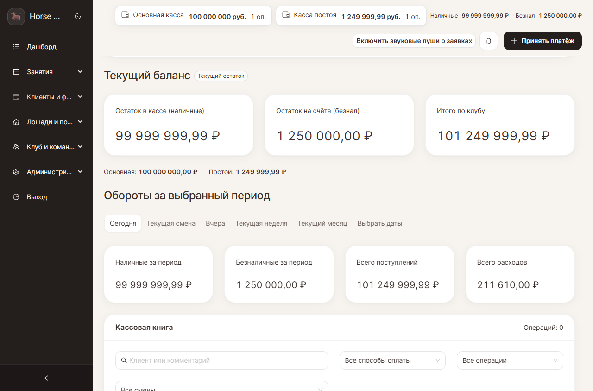
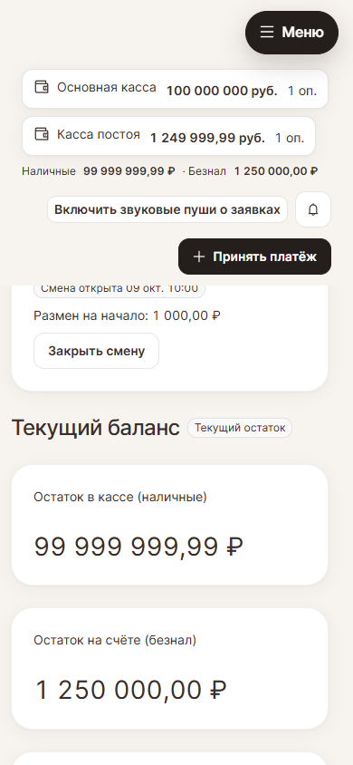

# Аудит кассы — 21 ноября 2026

Проверены `/cash-desk`, связанная шапка CRM, финансовые показатели dashboard, `cashbox`, `payments`, `finance`, возвраты услуг, закрытие смен и периодов. Использованы проектные скиллы `crm-financial-integrity`, `nestjs-crm-architect`, `react-tailwind-ui-polish`, `playwright-e2e-guardian`, правила `AGENTS.md`, `DESIGN.md` и `UX-CONTRACT.md`.

Это аудит кода и локальных сценариев с изолированными данными. Производственные проводки, реальные остатки и состояние миграций на VDS не проверялись и не менялись.

## Найдено и исправлено

| Приоритет | Проблема | Результат |
| --- | --- | --- |
| Высокий | Шапка читала `v_cashbox_balances`, а касса и dashboard — другой расчёт; SQL-представление не исключало будущие операции. | Денежные остатки шапки теперь используют тот же `currentCashBalance` в RepeatableRead. Основная / Постой рассчитываются общим `cashboxBalances`, также с границей текущего времени. SQL-представление на сервере не переписывается. |
| Высокий | Инкассация считала доступные наличные отдельным запросом без такой временной границы. | Использует `currentCashBalance` внутри своей Serializable-транзакции с блокировкой таблиц. |
| Высокий | Создание и отмена обычного расхода, открытие и закрытие смены не создавали события `CashAuditLog`. | События создаются в одной транзакции с действием. Ошибка аудита откатывает финансовую запись; повтор расхода с тем же requestId возвращает прежнюю запись без второго события. |
| Высокий | Через общий API платежей можно было провести оплату без автора и ключа, либо установить REFUNDED без расхода. Удаление неоплаченного начисления не имело аудита. | Новое PAID-поступление требует автора и requestId, повтор сверяет payload, изменения PENDING → PAID фиксируют автора/смену/аудит. REFUNDED напрямую запрещён. Удаление непроведённого начисления сохраняет снимок в аудите; проведённые платежи остаются неудаляемыми. |
| Высокий | Общий API позволял обойти кассовое проведение занятия/абонемента и повторно активировать отменённое начисление. | PAID для занятия/абонемента принимается только через кассовый сервис. Кнопка в списке платежей открывает drawer с выбранным основанием; отменённые начисления не редактируются. Оба основания проверены E2E. |
| Высокий | Заднее внесение расхода в закрытую кассовую смену и отмена её расхода не проверялись сервисом. | Добавлена проверка закрытой смены в Serializable. Тот же контроль применяется к датированным поступлениям общего API. Администратор тоже не обходит запрет: отдельного механизма переоткрытия в этой задаче не добавлено. |
| Средний | Ошибки SQL-защиты закрытого финансового периода могли становиться непонятной серверной ошибкой. | В кассовых платежах, общем API платежей и расходах преобразуются в 409 с понятным сообщением. |
| Средний | Остатки и расходы за период смешивались в одной сетке, крупные суммы использовали неподходящий размер. | Три текущих остатка отделены от четырёх оборотов. Использованы шаг 24 px, адаптивный шрифт, tabular-nums, nowrap и контейнерная ширина; деньги не обрезаются. |
| Средний | Кассовая книга показывала только поступления, поиск и общие фильтры отсутствовали. | Новый `/finance/journal` объединяет поступления, расходы, возвраты и инкассацию. Поиск по клиенту/комментарию, нал/безнал, приход/расход, смена, период и стабильная серверная пагинация. |
| Средний | Список платежей предлагал снять отметку с проведённой оплаты, хотя сервер запрещает это. | Неприменимая кнопка убрана, успешная оплата обновляет шапку через существующее событие. |

## Формулы и источники

- Наличные сейчас: PAID-поступления CASH минус неотменённые расходы CASH до текущего момента. Исключаются архивные записи; дата поступления — paidAt, при его отсутствии createdAt.
- Безнал сейчас: CARD / CARD_TERMINAL / SBP / TRANSFER минус расходы CARD с теми же границами.
- Итого клуба дополнительно включает исторические оплаты UNSPECIFIED. Если они есть, экран поясняет эту часть суммы отдельным бейджем, не приписывая её наличным или банку.
- Основная / Постой: поступления разделяются по boardingContractId; возврат относится к кассе исходного платежа. Остальные расходы относятся к основной кассе — отдельного поля кассы у Expense сейчас нет.
- Размен на начало смены — снимок физических наличных, а не новое поступление; повторно в баланс не добавляется.
- Обороты зависят от выбранного московского периода и текущей смены. Текущие остатки от этих фильтров не зависят. Дополнительные фильтры внутри журнала относятся к журналу.
- Все расчёты на сервере используют Prisma Decimal. Балансы шапки, кассы и dashboard проверены на одинаковых данных до копейки. Независимые HTTP-снимки могут различаться при операции между запросами; идентичность времени запросов не обещается.

## Прохождение интерфейса

1. **Текущие остатки — проверено.** Отдельная секция с бейджем, итогом клуба и разбивкой касс; суммы 211 610,00 / 1 250 000,00 / 99 999 999,99 ₽ и итог 101 249 999,99 ₽. Проверены границы текста каждой из семи карточек, отсутствие обрезания и горизонтального переполнения на 1440, 1280, 1024 и 390×844.
2. **Периоды — проверено.** Сегодня, вчера, неделя, месяц, текущая смена и произвольные даты. Границы Europe/Moscow, незаданная дата и отсутствие открытой смены. Остатки сохраняются при смене периода.
3. **Журнал — проверено.** Общий список, поиск, очистка с возвратом фокуса, методы, приход/расход, прошлая смена, пустое состояние, ошибка и повтор. UUID смены проверяется до отправки. Фильтры хранятся в URL. История расходов сохранена для управляемой отмены.
4. **Приём оплаты и расход — проверено.** Использован существующий drawer; наличные, СБП, сдача, ошибка, повтор с тем же ключом и сохранение полей. READ_ONLY не может проводить операции, TRAINER перенаправляется на своё рабочее место.
5. **Инкассация и закрытие — проверено.** Инкассация и сброс доступны ADMIN; закрытие периода защищено правом записи. Проверены подтверждения, неуспешная отправка, месячный перенос авансов, запрет повторного закрытия. Просмотр сверки доступен READ_ONLY, подтверждение закрытия заблокировано.

Скриншоты текущего прогона:

Дополнительно: `reports/cash-audit-before.png`, `reports/cash-audit-after.png`, `reports/cash-metrics-1440.png`, `reports/cash-metrics-1024.png`. Скриншоты мобильного экрана показывают видимую часть; автоматическая проверка прокручивает и измеряет все карточки. Полная доступность скринридером по одним скриншотам не утверждается.

## Финансовые границы

Существующие возвраты сохраняют исходный PAID-платёж и создают Expense с refundPaymentId; это предотвращает двойное уменьшение остатка. Проверены частичный возврат неиспользованных занятий, ограничение фактической оплатой, сохранение удержанной суммы, возврат постоя на банк, повторная отмена и запрет возврата при READ_ONLY. Уникальный refundPaymentId и Serializable-сценарии сохранены.

Закрытые месяцы/периоды дополнительно защищены существующими триггерами `guard_cash_period` / `assert_financial_period_open`. Изменения существующих миграций и обход защиты не вносились. Перепроведение оплаты занятия и абонемента остаётся защищено операционным ключом и транзакцией; проведённые зарплаты и связанные расходы сохраняются.

## Выполненные проверки

| Команда / набор | Результат |
| --- | --- |
| `npm.cmd --prefix backend run typecheck` | Успешно |
| `npm.cmd --prefix backend run lint` | 0 ошибок; 3 прежних предупреждения в посторонних тестах |
| `npm.cmd --prefix backend run build` | Успешно |
| `npm.cmd --prefix backend test` | 835 passed, 25 skipped, 0 failed |
| `npm.cmd --prefix frontend run typecheck` | Успешно, включая TypeScript E2E |
| `npm.cmd --prefix frontend run lint` | 0 ошибок и предупреждений |
| `npm.cmd --prefix frontend run build` | Успешно |
| `npm.cmd --prefix frontend test` | 191 passed |
| Playwright `cash-desk.spec.ts`, `dashboard.spec.ts` | Расширенный прогон: 77/78 прошли сразу; тест delayed preferences дашборда прошёл отдельным повтором. Новые/уточнённые сценарии кассы повторены отдельно — 7/7. |
| Playwright `crm-update.spec.ts --grep "cashbox links"` | 2/2 прошли |
| Дополнительные новые тесты invalid journal shift и оплаты из списка | 3/3 прошли; итого покрыты 83 уникальных браузерных сценария с учётом повторов |
| `RUN_CASH_AUDIT_SQL_TESTS=1 node --test test/cash-audit.postgres.test.cjs` | 1/1 на временном PostgreSQL 18 |

Playwright запускался из frontend через `npm.cmd exec -- playwright test --config=playwright.crm.config.ts --project=mock ...`, браузер Edge. Начальные неуспехи новых селекторов исправлены: для Select используется клавиатурное открытие, закрытие drawer ищется по его точному доступному имени. Нестабильный тест предпочтений дашборда не скрыт увеличением таймаута.

Основная локальная БД `127.0.0.1:5433` недоступна. Для новых SQL-запросов был создан отдельный временный кластер на 55439; тест использовал только TEMP-таблицы с ON COMMIT DROP. Проверены реальные SQL-параметры, копейки, будущие/архивные операции, возврат постоя, отменённые расходы, буквальный поиск `%_`, счётчик и страницы без дублей. Миграции не запускались. Кластер остановлен и удалён. Остальные интеграционные тесты, требующие полной БД, пропущены штатными флагами; проверка всех производственных триггеров на VDS остаётся за пределами локального прогона.

Строгий `audit_project.py --mode strict` выполнен до и после: 246 прежних замечаний по репозиторию и один дополнительный ложный сигнал `ownership.native-select-conflict` на импортированный Ant Design Select в CashJournal. Нативного HTML select там нет; настоящий popup проверен браузером. JSON: `reports/cash-premium-before.json`, `reports/cash-premium-after.json`. Этот общий статический аудит не зелёный; ошибки в других модулях не включались в финансовую задачу.

## Совместимость и выпуск

Схема Prisma не менялась; генерация Client и новая миграция не требуются. Уже существующие финансовые миграции на сервере должны быть применены для защиты закрытых периодов.

Клиенты, создающие PAID напрямую через POST `/payments`, теперь должны передавать requestId (UUID). Автор берётся из сессии. Для занятий и абонементов используется POST `/payments/cash-desk`; внутренний экран открывает соответствующий drawer с выбранным основанием. Постой и ручные начисления сохраняют PATCH существующего начисления. Основной drawer оплаты уже отправляет свой ключ. Прямое присвоение REFUNDED заменяется существующим сценарием отмены услуги с возвратом.
