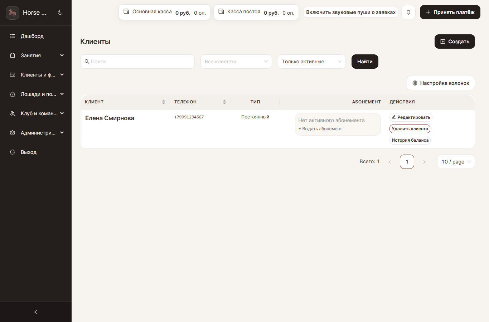
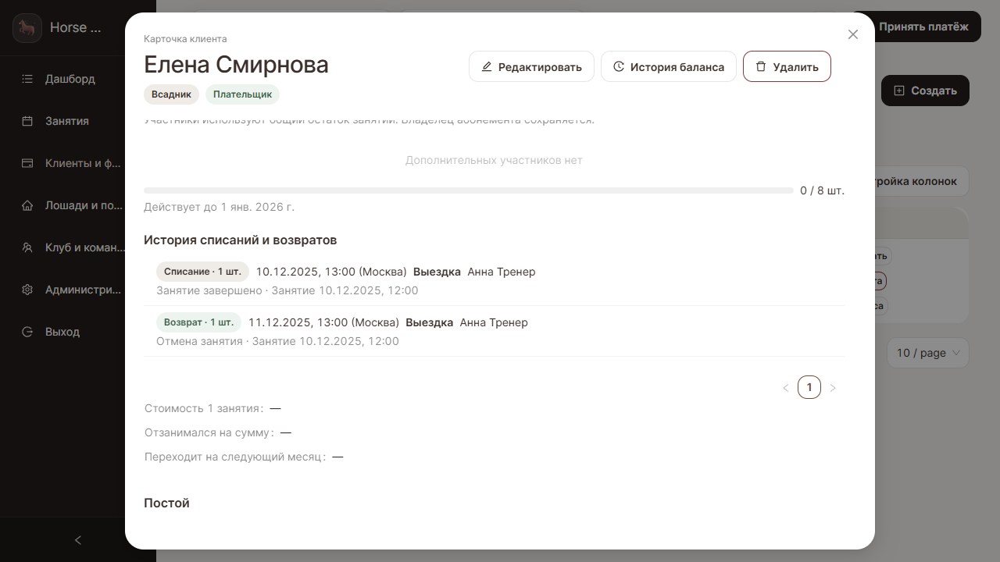
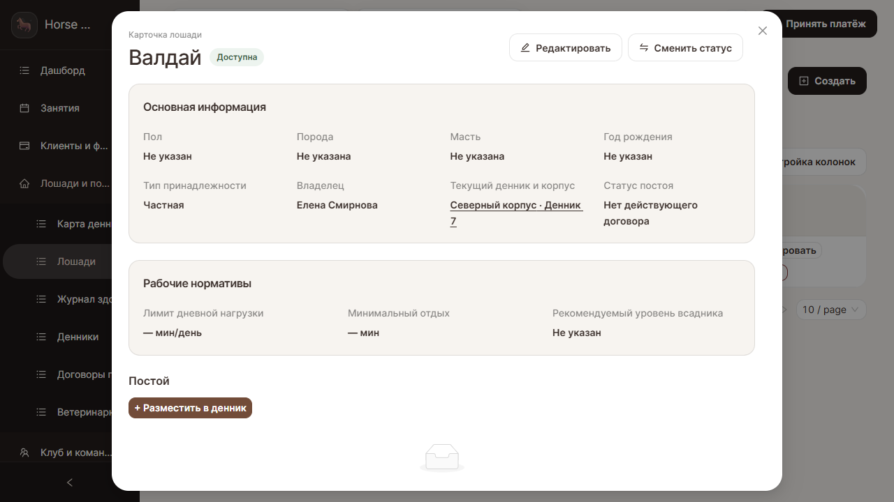
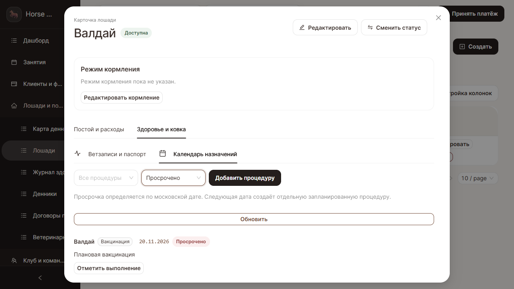

# Аудит операционного контура — 21.11.2026

Проверены Clients → Memberships → Lessons/Bookings → Horses → Stalls → Vet на уровне сервисов, DTO, SQL-триггеров, карточек и браузерных сценариев. Ветеринарные сервисы находятся в `backend/src/boarding/`, интерфейс — в `frontend/src/pages/stable/`.

## Найдено и исправлено

1. **История абонементов отсутствовала в карточке клиента.** API возвращает DEBIT/REFUND с датой, тренером и названием услуги, а также операции самостоятельных тренировок. Проекции MembershipOp в LedgerTransaction исключены из повторного отображения; CREDIT и денежные возвраты продажи не выдаются за списания занятий. Сохранены завершённые семейные абонементы. История идёт от старых операций к новым, по 5 на страницу; остатки — в шт., депозиты — в рублях. Ошибка загрузки карточки имеет кнопку повтора; запрос карточки проверяет UUID.
2. **Не проверялось начало срока действия в прежнем контуре занятий.** Проверка `validFrom` добавлена при записи, выборе абонемента, оплате и атомарном списании. Просроченные, замороженные и исчерпанные абонементы по-прежнему блокируются; овердрафт не вводился.
3. **Не было безопасной отвязки уже использованного абонемента.** Добавлен `POST /lessons/:id/bookings/:bookingId/unlink-membership`, тело `{ "reason": "Причина" }`. Доступ: ADMIN/MANAGER и FULL SCHEDULE; UUID и непустая причина валидируются. В одной Serializable-транзакции возвращается занятие, снимается привязка, создаётся ожидающая разовая оплата и аудит с автором/временем/причиной. Для проведённого занятия выручка переносится компенсирующими проводками без удаления истории. Повторный запрос не возвращает второе занятие. Интерфейс общей правки Booking не допускает изменения завершённых записей; новый endpoint предназначен для явного исправления оплаты.
4. **Отмена проведённой самостоятельной записи не возвращала занятия.** Отмена клубом записей `completed`/`no_show`, оплаченных абонементом/депозитом, возвращает ровно исходное списание, сторнирует выручку и пишет аудит в той же транзакции. Повторная/конкурентная отмена безопасна. Остальные переходы между конечными статусами остаются запрещёнными.
5. **Карточка лошади не получала владельца и фактическое размещение.** Добавлены владелец, денник с корпусом и статус действующего договора. Фактический денник берётся из `Horse.stall`, независимо от истории договоров. Ссылка `/stable?stallId=UUID` открывает его на карте. В быстрой форме используется владелец лошади, а не клиент последнего исторического договора.
6. **В календаре не было отдельных фильтров статусов.** Добавлены «Просрочено», «Ближайшие 14 дней», «Выполнено». Фильтр применяется в SQL до пагинации и подсчёта; просрочка определяется по полуночи Europe/Moscow. На общей странице статус сохраняется в URL, в карточке лошади — локально. Пустые UUID/enum-фильтры нормализуются. Финансовые операции нового поля `transactions` закрыты существующим RBAC-санитайзером.

## Подтверждённые инварианты

- Повторное проведение не списывает второе занятие; отмена Lessons возвращает только существующие DEBIT без повторного REFUND. Проверены обычный и семейный абонементы, конкуренция за последнее занятие, откат при сбое журнала.
- `Stall.horseId @unique`, ограничение согласованности заполнения и Serializable-операции размещения/рокировки уже защищают правило «одна лошадь — один денник». Перенос освобождает прежний денник и синхронизирует `AVAILABLE/OCCUPIED` и номер у лошади. Новая дублирующая схема размещения не вводилась.
- Ветеринарное закрытие идемпотентно, следующая дата создаёт одно назначение; проверены параллельное закрытие, карантин/лечение, массовое создание и история/паспорт.
- Таблица `/clients` уже имела ширину 100%, компактные ячейки и карточки абонементов до 240 px. Перевёрстка не потребовалась: проверены document/table overflow на 1366 и 1440 px и существующие сценарии с длинным содержимым до 390 px.

## Проверки

| Проверка | Результат |
|---|---|
| Backend/frontend `npm run typecheck` | Пройдены, включая TypeScript Playwright |
| Backend/frontend `npm run lint` | Ошибок нет; 3 существующих предупреждения backend в других тестах |
| Backend/frontend `npm run build` | Пройдены |
| `npm --prefix backend test` | 842 passed, 26 PostgreSQL-сценариев skipped в обычном запуске, 0 failed |
| `npm --prefix frontend test` | 23 файла, 191 passed |
| Playwright, `playwright.operations.config.ts` | 64 passed; повторный целевой прогон 4 новых сценариев также пройден |
| `test:memberships:postgres` | 20 passed: продажа, выручка, конкуренция завершения/отвязки, реальный rollback при ошибке аудита, отмена после отвязки |
| `test:stalls:postgres`, `STALL_TEST_FOCUSED=1` | 26 passed, включая PostgreSQL размещение и рокировку |
| `test:operations:postgres` | 31 passed: самостоятельные записи, возвраты занятий/депозита, постой, веткалендарь и ветзаписи |
| `npx prisma validate` | Пройдено |

Логи сохранены в `docs/reports/operations-*.log`. На Windows команды выполнялись через `npm.cmd`/`npx.cmd`, поскольку PowerShell блокирует npm.ps1. Для интеграционных тестов поднят отдельный временный PostgreSQL 18 на loopback; каждый runner использовал свою одноразовую БД/схему. Рабочая БД приложения не мигрировалась.

Формы создания/закрытия процедуры в календаре используют существующую боковую шторку EntryOverlay, как ветзаписи и быстрые действия дашборда. Временный кластер после проверок остановлен и удалён.

Дополнительный эвристический `frontend-design-premium` strict-аудит выдал 247 замечаний по всему frontend (лог `operations-ui-static-audit.log`), включая распознавание Ant Design Form/Select как нативной разметки. Этот статический аудит не прошёл и требует отдельной проверки замечаний; он не подменяет пройденные линтеры, TypeScript и браузерные сценарии. Полная WCAG-сертификация и проверка production-данных не проводились.

## Миграция и выпуск

Требуется `20261121160000_membership_unlink_revenue`: безопасный `CREATE OR REPLACE FUNCTION` для переноса/сторнирования выручки при отвязке и корректного распределения округления после возврата. Сохранены номинальная цена услуги, закрытые финансовые периоды, неизменяемость проводок и `v_cashbox_balances`. Данные, таблицы и столбцы не удаляются; `schema.prisma` не менялась, генерация Prisma Client не требуется.

На сервере выполнить `npx prisma migrate deploy` **до запуска нового backend**. Миграция проверена на чистых временных PostgreSQL-БД со всей историей миграций. Серверный деплой в рамках задачи не выполнялся.

## Браузерные свидетельства

1. Список клиентов при 1366 px: нет горизонтального переполнения.

2. Завершённый абонемент: остаток, списание и возврат с датой, услугой и тренером.

3. Карточка лошади: владелец, фактический денник/корпус и отдельный статус договора.

4. Веткалендарь лошади: выбранная просрочка, процедура и действие закрытия.

Скриншоты получены на изолированных API-моках и визуально просмотрены. Транзакции, SQL-триггеры и конкуренция проверялись отдельно на настоящем PostgreSQL.
