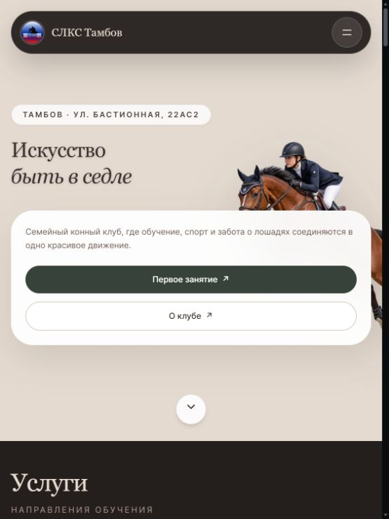
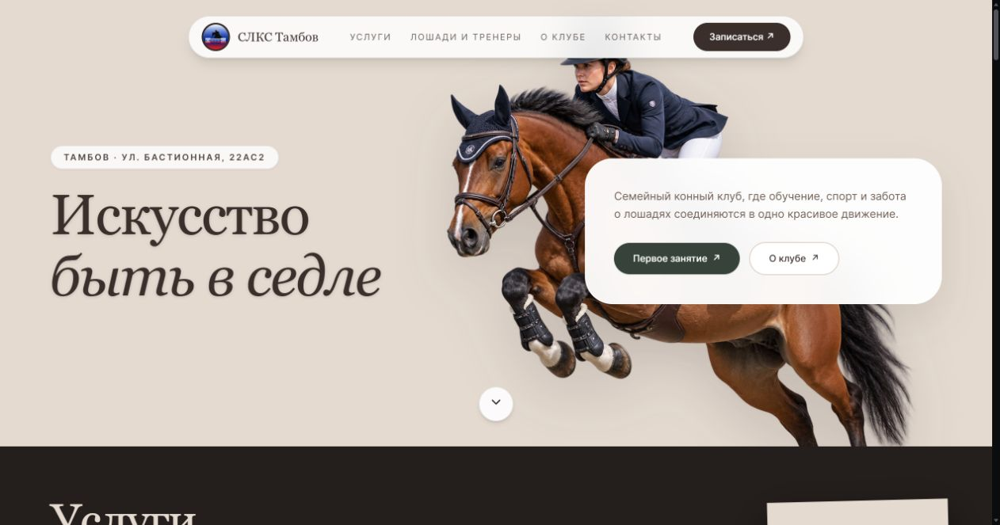
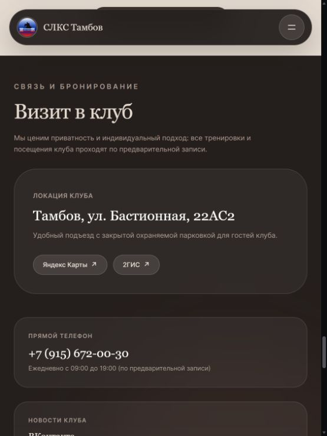
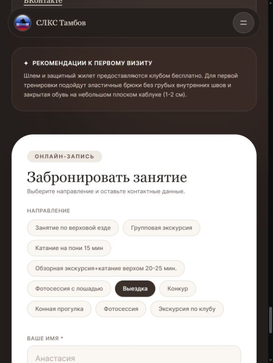
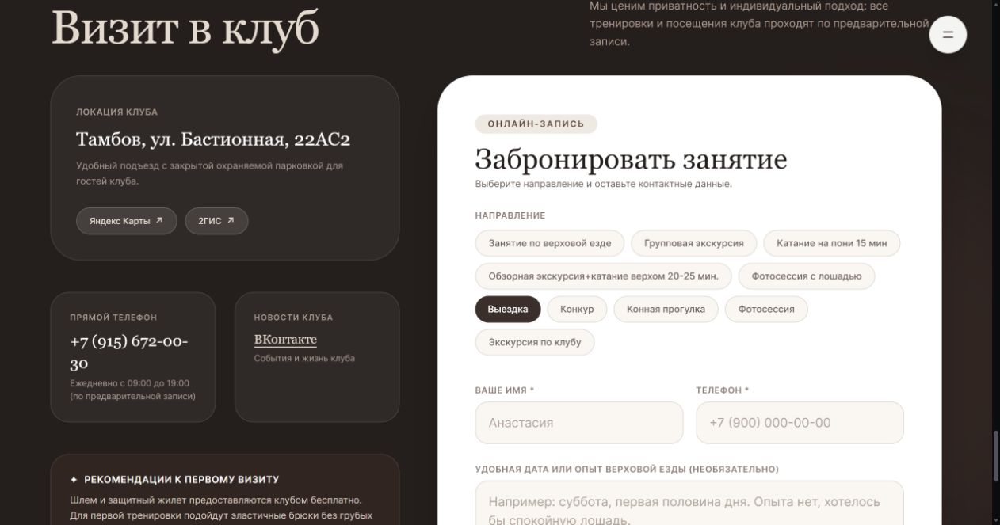
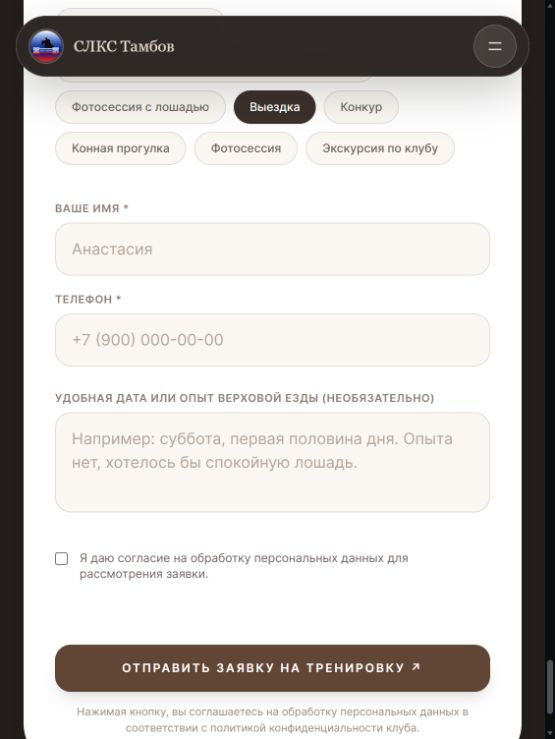
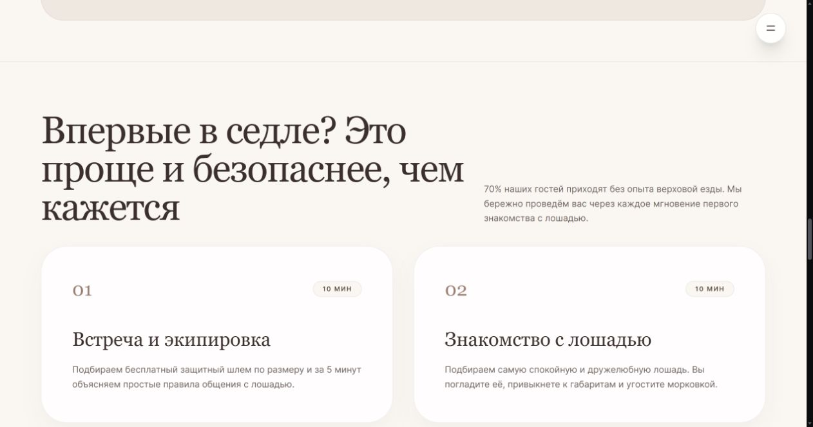

# CRO-аудит horseclub68.ru

Дата: 21 октября 2026 года. Цель: больше заявок на первое (пробное) занятие. Только рекомендации, код сайта не менялся, заявки не отправлялись.

Проверена живая страница https://horseclub68.ru/ в Edge: узкая существующая вкладка и отдельная широкая вкладка. Это визуальная и содержательная проверка, а не тест на реальном телефоне. Источники трафика, показатели конверсии и CRM-результаты недоступны. Предполагаемая аудитория рекомендаций — новые посетители без опыта и родители, выбирающие первое занятие. Изменение конверсии требует измерения.

## Вывод

Страница создаёт образ красивого спортивного клуба, но путь новичка до заявки требует лишних решений. Приоритет: конкретное предложение первого занятия на первом экране, прямой переход к форме и соответствующий выбор услуги.

Сильные стороны: заметные основные кнопки, адрес на первом экране, цена и длительность в услугах, отдельное объяснение первого визита, бесплатная экипировка по тексту сайта. В форме обязательны только имя и телефон; комментарий необязателен, подписи полей остаются видимыми.

## Проверенные шаги

### 1. Первый экран — предложение требует уточнения

Заголовок «Искусство быть в седле» передаёт атмосферу, но не сообщает, что можно начать без опыта. Подзаголовок говорит о клубе в целом. На первом экране нет цены, длительности и содержания первого занятия. Фото всадника на прыжке показывает спортивный результат; гипотеза: новичку легче узнать себя в фотографии знакомства с лошадью рядом с тренером.

Рекомендация высокого приоритета: поставить конкретное предложение первого занятия на первый экран. Сохранить исходную фразу как второстепенный брендовый текст. Фото реального первого занятия проверить отдельным экспериментом.

### 2. Нажатие «Первое занятие» — лишняя прокрутка в узком окне

Кнопка ведёт к #contacts. В узкой вкладке сначала видны «Визит в клуб», адрес и телефон; форма находится ниже карточек контактов и рекомендаций. Человек нажал кнопку записи, но не получил поля для заявки сразу.

Рекомендация высокого приоритета: кнопки записи на первое занятие должны вести прямо к форме с уже выбранным первым занятием. После перехода заголовок формы должен оставаться видимым, без перекрытия навигацией. Для интересующихся оставить отдельную текстовую ссылку «Как проходит первое занятие».

### 3. Выбор направления — перегружен и не соответствует первому занятию

В форме десять направлений. Есть близкие по смыслу варианты «Фотосессия с лошадью» и «Фотосессия», а также несколько экскурсий. Новичку предлагают выбирать среди спортивных дисциплин. В отдельной вкладке после кнопки «Записаться на первое занятие» отмечена «Выездка». Источник этого выбора в коде не исследовался; наблюдение воспроизведено в текущем браузере, но отдельный чистый профиль не проверялся.

Рекомендация высокого приоритета: для этого пути показывать «Первое занятие по верховой езде» как выбранную услугу. Прочие предложения убрать под ссылку «Выбрать другую услугу». Если нужна сегментация, вместо дисциплин предложить «Для себя / Для ребёнка» без обязательного усложнения заявки. В общем каталоге унифицировать названия и удалить смысловые дубли после проверки реальных услуг.

### 4. Поля и отправка — короткая форма, но неясный результат

Два обязательных контактных поля — хорошая основа. «Удобная дата или опыт верховой езды» объединяет разные вопросы; поле выглядит содержательно сложнее, чем требуется для первого контакта. Заголовок «Забронировать занятие» обещает бронирование, но форма не предлагает время. Кнопка «Отправить заявку на тренировку» описывает другой уровень обязательств. Рядом нет ясного объяснения следующего шага и времени ответа.

Рекомендация: назвать форму «Запись на первое занятие», а кнопку «Оставить заявку на первое занятие». Подзаголовок: «Оставьте телефон. Администратор свяжется с вами и поможет выбрать время». Использовать это обещание, только если оно соответствует процессу клуба. Реальный срок ответа указать после согласования с администратором, не придумывать его.

Оставить поля: «Ваше имя», «Телефон для связи», «Пожелания к занятию (необязательно)». Пример комментария: «Для ребёнка, удобно в выходные». Не заставлять выбирать дату без доступного расписания. Обязательное согласие сохранить; ссылку на политику сделать заметной и доступной для открытия рядом с согласием. Это рекомендация удобства, не правовая оценка.

После успешной заявки рекомендуемый текст: «Заявка получена. Администратор свяжется с вами, чтобы согласовать время первого занятия». Уточнение «Запись будет подтверждена после согласования времени» применять, если именно так работает клуб. Состояние успеха и доставка заявки не проверялись.

### 5. Объяснение первого визита — полезное содержание находится далеко от первого экрана

Блок объясняет знакомство с лошадью и экипировку. Но перед ним расположены услуги, лошади и наставники, стандарты клуба. Для цели первого занятия этот блок стоит поднять сразу после первого экрана или короткой карточки предложения.

По DOM текущей страницы этапы обозначены как 10 + 10 + 20 + 20 минут, всего 60 минут. В услугах занятие стоит 2 200 ₽ и длится 45 минут. Это могут быть разные продукты или длительность занятия и всего визита, но связь не объяснена. Сначала уточнить фактическое предложение, затем показывать одну понятную цену и отдельно время занятия и визита, если они различаются. Не переносить 2 200 ₽ на пробное занятие без подтверждения.

Фразы «Протокол нулевого риска» и «она не побежит и не сделает резких движений» заменить описанием действий тренера и мер подготовки без абсолютных обещаний. «70% наших гостей» и снижение нагрузки «до 40%» оставлять только при наличии основания. Это вопросы доверия к тексту, не проверка безопасности клуба.

## Готовые варианты первого экрана

Основной вариант:

**Первое занятие верховой ездой в Тамбове — начните без опыта**

Познакомьтесь с лошадью и попробуйте верховую езду с тренером. Шлем и защитный жилет предоставим в клубе.

Основная кнопка: **Записаться на первое занятие**.

Второстепенная ссылка: **Как проходит занятие**.

Фактическую цену и продолжительность добавить возле кнопки после согласования условий пробного занятия. Бесплатная экипировка указана на текущей странице; перед публикацией убедиться, что это условие действует для данного предложения.

Альтернативы заголовка:

- «Никогда не сидели в седле? Начните с занятия с тренером» — акцент на отсутствии опыта.
- «Первое знакомство с верховой ездой для вас или ребёнка» — акцент на семейном выборе; использовать после подтверждения возрастных условий.

Альтернативы кнопок:

- «Записаться на первое занятие» — ясно называет цель.
- «Подобрать время первого занятия» — если после заявки действительно помогают подобрать время.
- «Оставить заявку на первое занятие» — точно описывает действие формы без обещания мгновенной брони.

## Приоритеты

1. Направить кнопки сразу к форме и убрать неподходящий выбор «Выездка» из пути первого занятия.
2. Согласовать цену, длительность и содержание первого занятия.
3. Переписать заголовок первого экрана и формы; объяснить следующий шаг после заявки.
4. Поднять блок первого визита, добавить рядом подлинный отзыв новичка или родителя с источником.
5. Проверить отдельным тестом фото знакомства с тренером вместо прыжка.

## Гипотезы и измерение

| Изменение | Гипотеза | Основная проверка |
|---|---|---|
| Конкретный заголовок вместо образного | Новичок быстрее понимает, что предложение ему подходит | Успешные заявки на первое занятие / посетители страницы |
| Прямой переход к форме | Меньше потерь между кнопкой и началом заполнения | Начавшие форму / нажавшие основную кнопку; затем успешные заявки |
| Первое занятие выбрано вместо десяти направлений | Меньше решений перед вводом контактов | Успешные заявки / начавшие форму |
| Фото новичка рядом с тренером | Визуальный образ соответствует намерению попробовать | Заявки и доля подтверждённых записей |

Изменения с очевидным несоответствием намерению посетителя исправить первыми. Эксперименты с заголовком и фото проводить последовательно, не менять всё одновременно. Если трафика мало, не объявлять победителя по нескольким заявкам.

Считать цепочку: просмотр страницы → основная кнопка → начало формы → успешное сохранение заявки → подтверждённая запись → состоявшийся визит. Отдельно смотреть узкие/широкие экраны и источники трафика. Клик на кнопку не равен заявке; число заявок не равно числу пришедших клиентов. Не отправлять содержимое контактных полей в события аналитики.

## Границы проверки

Не проверены: отправка и доставка заявки, валидация после отправки, состояние успеха, работа администратора, скорость загрузки на мобильной сети, полноценная клавиатурная доступность и контраст по WCAG. В дереве доступности варианты направлений представлены как checkbox; если допустим только один вариант, при реализации проверить семантику группы выбора. По снимкам нельзя подтвердить доступность формы целиком.

Сборка, линтеры и тесты приложения не запускались: изменения ограничены этим отчётом и снимками. Миграция Prisma не требуется.
