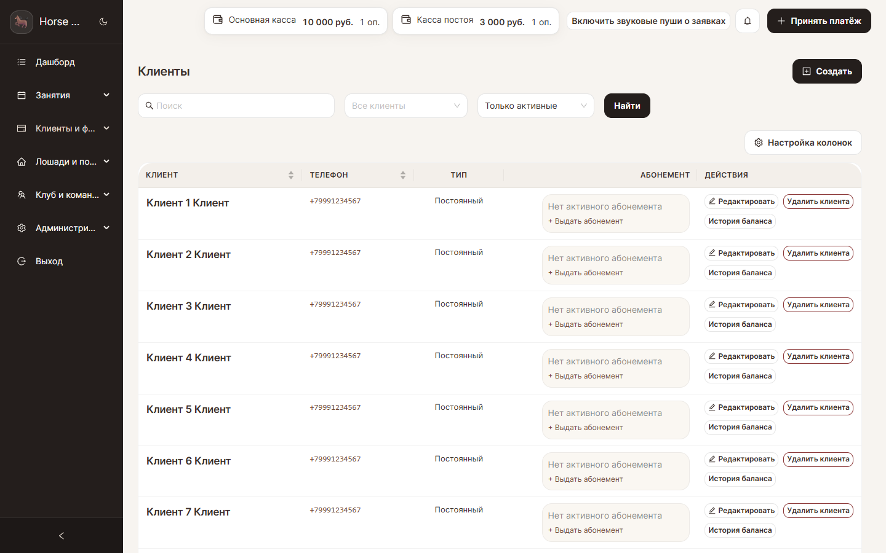
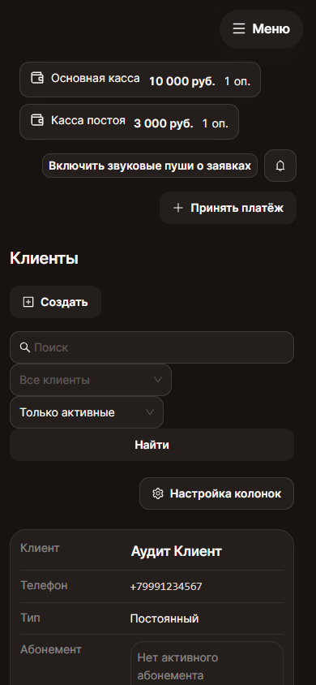
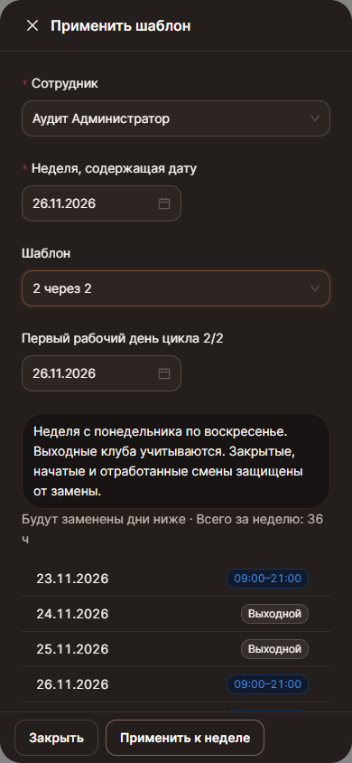
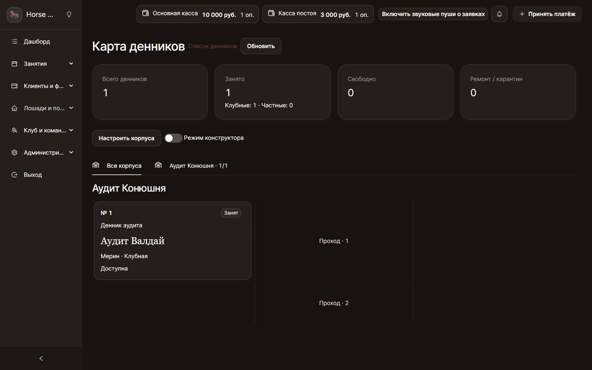

# Сквозной аудит Horse Club CRM — 26.11.2026

Проверяется настоящий React-интерфейс в Edge/Playwright с изолированными API fixtures. Четыре проекта: **1440×900 light/dark**, **390×844 light/dark**, локаль `ru-RU`, время клуба `Europe/Moscow`, фиксированная дата 26.11.2026. Продакшен не изменялся.

Сьют: [full-crm-audit.spec.ts](../../frontend/tests/e2e/full-crm-audit.spec.ts), [fixtures](../../frontend/tests/e2e/audit-fixture.ts), [конфигурация](../../frontend/playwright.full-crm-audit.config.ts). Все новые TypeScript-файлы проверяются с `strict: true`, без `any`.

## Проверенные экраны

Каждая строка проверяется во всех четырёх проектах. Ссылки ведут к сохранённым скриншотам текущего аудита.

| Маршрут | Фактический раздел | 1440 light | 1440 dark | 390 light | 390 dark |
|---|---|---|---|---|---|
| `/dashboard` | Рабочее место администратора | [PNG](full-crm-audit-2026-11-26/1440-light/dashboard.png) | [PNG](full-crm-audit-2026-11-26/1440-dark/dashboard.png) | [PNG](full-crm-audit-2026-11-26/390-light/dashboard.png) | [PNG](full-crm-audit-2026-11-26/390-dark/dashboard.png) |
| `/schedule` | Расписание занятий | [PNG](full-crm-audit-2026-11-26/1440-light/schedule.png) | [PNG](full-crm-audit-2026-11-26/1440-dark/schedule.png) | [PNG](full-crm-audit-2026-11-26/390-light/schedule.png) | [PNG](full-crm-audit-2026-11-26/390-dark/schedule.png) |
| `/clients` | Клиенты | [PNG](full-crm-audit-2026-11-26/1440-light/clients.png) | [PNG](full-crm-audit-2026-11-26/1440-dark/clients.png) | [PNG](full-crm-audit-2026-11-26/390-light/clients.png) | [PNG](full-crm-audit-2026-11-26/390-dark/clients.png) |
| `/memberships` | Абонементы | [PNG](full-crm-audit-2026-11-26/1440-light/memberships.png) | [PNG](full-crm-audit-2026-11-26/1440-dark/memberships.png) | [PNG](full-crm-audit-2026-11-26/390-light/memberships.png) | [PNG](full-crm-audit-2026-11-26/390-dark/memberships.png) |
| `/horses` | Лошади | [PNG](full-crm-audit-2026-11-26/1440-light/horses.png) | [PNG](full-crm-audit-2026-11-26/1440-dark/horses.png) | [PNG](full-crm-audit-2026-11-26/390-light/horses.png) | [PNG](full-crm-audit-2026-11-26/390-dark/horses.png) |
| `/stalls` | Список денников | [PNG](full-crm-audit-2026-11-26/1440-light/stalls.png) | [PNG](full-crm-audit-2026-11-26/1440-dark/stalls.png) | [PNG](full-crm-audit-2026-11-26/390-light/stalls.png) | [PNG](full-crm-audit-2026-11-26/390-dark/stalls.png) |
| `/boarding` | Переход на `/boarding-contracts` | [PNG](full-crm-audit-2026-11-26/1440-light/boarding.png) | [PNG](full-crm-audit-2026-11-26/1440-dark/boarding.png) | [PNG](full-crm-audit-2026-11-26/390-light/boarding.png) | [PNG](full-crm-audit-2026-11-26/390-dark/boarding.png) |
| `/vet` | Ветеринарный журнал | [PNG](full-crm-audit-2026-11-26/1440-light/vet.png) | [PNG](full-crm-audit-2026-11-26/1440-dark/vet.png) | [PNG](full-crm-audit-2026-11-26/390-light/vet.png) | [PNG](full-crm-audit-2026-11-26/390-dark/vet.png) |
| `/services` | Услуги | [PNG](full-crm-audit-2026-11-26/1440-light/services.png) | [PNG](full-crm-audit-2026-11-26/1440-dark/services.png) | [PNG](full-crm-audit-2026-11-26/390-light/services.png) | [PNG](full-crm-audit-2026-11-26/390-dark/services.png) |
| `/staff` | Сотрудники | [PNG](full-crm-audit-2026-11-26/1440-light/staff.png) | [PNG](full-crm-audit-2026-11-26/1440-dark/staff.png) | [PNG](full-crm-audit-2026-11-26/390-light/staff.png) | [PNG](full-crm-audit-2026-11-26/390-dark/staff.png) |
| `/shifts` | Переход на `/staff?tab=shifts` | [PNG](full-crm-audit-2026-11-26/1440-light/shifts.png) | [PNG](full-crm-audit-2026-11-26/1440-dark/shifts.png) | [PNG](full-crm-audit-2026-11-26/390-light/shifts.png) | [PNG](full-crm-audit-2026-11-26/390-dark/shifts.png) |
| `/finance` | Финансовые отчёты | [PNG](full-crm-audit-2026-11-26/1440-light/finance.png) | [PNG](full-crm-audit-2026-11-26/1440-dark/finance.png) | [PNG](full-crm-audit-2026-11-26/390-light/finance.png) | [PNG](full-crm-audit-2026-11-26/390-dark/finance.png) |
| `/settings` | Недельный режим работы | [PNG](full-crm-audit-2026-11-26/1440-light/settings.png) | [PNG](full-crm-audit-2026-11-26/1440-dark/settings.png) | [PNG](full-crm-audit-2026-11-26/390-light/settings.png) | [PNG](full-crm-audit-2026-11-26/390-dark/settings.png) |
| `/leads` | Заявки | [PNG](full-crm-audit-2026-11-26/1440-light/leads.png) | [PNG](full-crm-audit-2026-11-26/1440-dark/leads.png) | [PNG](full-crm-audit-2026-11-26/390-light/leads.png) | [PNG](full-crm-audit-2026-11-26/390-dark/leads.png) |
| `/stable` | Дополнительно: карта денников | [PNG](full-crm-audit-2026-11-26/1440-light/stable.png) | [PNG](full-crm-audit-2026-11-26/1440-dark/stable.png) | [PNG](full-crm-audit-2026-11-26/390-light/stable.png) | [PNG](full-crm-audit-2026-11-26/390-dark/stable.png) |

Общие проверки экранов: отсутствие `pageerror`, любых `console.error`, ответов HTTP ≥500 и неизвестных API endpoints; отсутствие горизонтального переполнения документа; тема действительно установлена в `html[data-theme]`. Ошибки собираются с начала навигации до завершения теста.

Прокручивается владелец скролла приложения `.crm-main`: середина → низ → верх. Измеряются X/ширина/высота контейнера, его `scrollHeight`, X/Y панели касс; допуск геометрии 1 CSS px. Подтверждается достижение низа и возврат в нулевую позицию. `elementFromPoint` проверяет, что видимые интерактивные элементы не перекрыты. Из проверки исключена служебная `aria-hidden` копия заголовка rc-table, предназначенная для измерения ширины колонок.

Отдельный заполненный каталог содержит 31 клиента: desktop-таблица / мобильные карточки, фактическая прокрутка длинного контента, страницы 1→2→3→4, блокировка следующей страницы на границе и возврат на страницу 3 с проверкой API `_start`. Для пустых мобильных каталогов проверено отсутствие пагинации «1 / 0».

## Сквозные сценарии

1. **Клиент → абонемент → касса.** Создание клиента через форму; продажа 8 занятий по 1500 ₽; варианты CASH и CARD. Проверяется payload продажи и автоматическое обновление верхней основной кассы **10 000 → 22 000 ₽**, без перезагрузки страницы. Касса постоя остаётся **3000 ₽**.
2. **Расписание → предупреждения → списание.** Через UI выбираются клиент, услуга, тренер и лошадь с отключённым направлением `allowWalk`. Оба мягких предупреждения видимы и не мешают сохранению. Выбирается абонемент, занятие создаётся, открывается из календаря, отмечается присутствие. Проверяется запрос завершения и остаток **7 / 8** в карточке клиента.
3. **Лошадь → денник → постой.** Проверяются все четыре тумблера направлений и их значения; заполненная карта корпуса с занятой лошадью; карточка договора; приём **25 000 ₽** по выбранному договору. Верхняя касса постоя обновляется **3000 → 28 000 ₽**, основная остаётся прежней.
4. **Клуб → смены → CRM-доступ.** Чтение и сохранение всех семи дней недели, отключение воскресенья; выбор шаблона 2/2, предпросмотр семи дней без отправки мутации, применение с проверкой семи дат. Собственный доступ в CRM отключить нельзя; доступ другого сотрудника выключается с подтверждением и включается обратно.
5. **Финансы → журнал.** KPI «Наличные», «Безналичные», «Продажи абонементов» открывают журнал. Проверяются URL-фильтры `method`/`operation`/`source` и соответствующие параметры API `paymentMethod`/`operationType`/`source`.
6. **Роли.** ADMIN проходит все разделы. TRAINER при прямом открытии настроек, персонала, смен, финансов, кассы, постоя и заявок остаётся в `/trainer`; кассовые действия отсутствуют. Из `/schedule` открывается рабочее место тренера, отметка собственного занятия отправляет `COMPLETED` и обновляет карточку.

Все перечисленные сценарии выполняются на обоих размерах в обеих темах, без `skip` и повторных попыток в новом сьюте.

## Выявленные и исправленные дефекты

| Дефект | Исправление |
|---|---|
| `/boarding` и `/shifts` показывали 404 | Добавлены переходы к существующим договорам и вкладке смен; `/shifts` включён в модуль STAFF_PAYROLL. |
| Карточка KPI заявок вела на отсутствующий `/leads` | Создан экран с существующими `useWorkspace` и `PendingLeads`, маршрут включён в SCHEDULE. |
| Мобильная пагинация Refine не отправляла запрос следующей страницы | `ResponsiveTable` передаёт событие пагинации верхнему обработчику таблицы; фильтры и сортировка сохраняют владельца в Refine. |
| Пустые мобильные каталоги показывали «1 / 0» | Пагинация нулевого списка скрывается, явная настройка `hideOnSinglePage` сохраняется. |
| `rc-select@14.16.8` обращался к `element.ref` и вызывал ошибку консоли React 19 | Воспроизводимый postinstall-патч читает `props.ref` в React 19; применяется к ES и CommonJS сборкам зависимости. |
| `rc-util` ошибочно считал повторно используемые значения соседних ветвей циклом | Патч сравнения хранит текущую цепочку предков; добавлены 3 unit-теста на общие ссылки, изменённые значения и shallow comparison. |
| Тумблеры лошади одновременно задавали начальные значения Form и Form.Item | Удалён дублирующий `initialValue`, сохранены defaults формы и значения редактируемой записи. Старые тесты создания лошади прошли в обеих темах. |
| Заметки карточки договора имели `span: 2` при мобильной одной колонке | Использован `span: 'filled'`, устранено предупреждение Ant Design и переполнение сетки описаний. |

Патчи зависимостей находятся в [patch-ui-dependencies.cjs](../../frontend/scripts/patch-ui-dependencies.cjs), автоматически выполняются после `npm ci`. Они идемпотентны; при несовместимом обновлении зависимости установка явно попросит пересмотреть патч. После применения к уже работающему Vite нужен перезапуск с `--force`.

## Проверки и воспроизведение

```powershell
npm.cmd --prefix frontend run lint
npm.cmd --prefix frontend run typecheck
npm.cmd --prefix frontend test
npm.cmd --prefix frontend run build
npm.cmd --prefix frontend run test:e2e:audit -- --workers=4
npm.cmd --prefix backend run lint
npm.cmd --prefix backend run typecheck
npm.cmd --prefix backend test
npm.cmd --prefix backend run build
```

| Проверка | Результат | Лог |
|---|---|---|
| Frontend lint | PASS, ошибок нет | [лог](full-crm-audit-frontend-lint.log) |
| Frontend typecheck | PASS, приложение и строгий TypeScript E2E | [лог](full-crm-audit-frontend-types.log) |
| Frontend unit | PASS, 31 файл / 241 тест | [лог](full-crm-audit-frontend-unit.log) |
| Frontend build | PASS | [лог](full-crm-audit-frontend-build.log) |
| Новый Playwright-сьют | PASS, **92 / 92**, 4 проекта, 0 retries | [лог](full-crm-audit-playwright.log), [JSON](full-crm-audit-results.json) |
| Создание лошади, прежний E2E | PASS, 2 / 2, light/dark | [лог](full-crm-audit-horse-defaults.log) |
| Backend lint | PASS, 0 ошибок; 3 существующих предупреждения в старых тестах | [лог](full-crm-audit-backend-lint.log) |
| Backend typecheck | PASS | [лог](full-crm-audit-backend-types.log) |
| Backend unit | PASS, **957 passed**, 27 skipped из 984 | [лог](full-crm-audit-backend-unit.log) |
| Backend build | PASS | [лог](full-crm-audit-backend-build.log) |

Последний прогон нового сьюта завершился с кодом 0 после исправления пустой пагинации; последние frontend lint/typecheck/build/unit также завершились с кодом 0. Prisma schema не менялась.

Дополнительно запущен strict static audit навыка frontend-design-premium. Его 279 сообщений проверены существующим AST-классификатором: все 279 — ложные срабатывания HTML-парсера на `Form.Item` и импортированный Ant Design `Select`; непроверенных сообщений 0, все 33 настоящие формы имеют `noValidate`. Исходный результат не подавлялся: [raw JSON](full-crm-audit-premium.json), [AST-классификация](full-crm-audit-premium-classified.json).

## Скриншоты

Сохранено 88 исходных PNG: 60 экранов и 28 снимков бизнес-сценариев. Итоговые доказательства — отдельные PNG по ссылкам в таблице и ниже. Обзорные JPG в папке создавались при визуальном просмотре до последней правки пустой пагинации и не являются финальными снимками этого состояния.

Десктоп, заполненный список клиентов:



Мобильный экран в тёмной теме:



Предпросмотр смены:



Заполненная карта денников:



## Границы доказательств

- Это сквозная проверка браузера и HTTP-контрактов **на API fixtures**, дополненная backend-тестами. Настоящий PostgreSQL, транзакции на живой БД, реальные ADMIN/TRAINER учётные записи и продакшен этим Playwright-сьютом не проверены. Финансовые изменения и остатки в нём моделируются; серверные инварианты отдельно проверяются backend-тестами. Пропущенные PostgreSQL-интеграционные тесты отмечены в логе.
- Внешние Google Fonts изолированы пустым CSS: снимки используют системный fallback шрифта. Погода Open-Meteo фиксирована тестовыми данными. Реальные доступность внешних сервисов и загрузка веб-шрифтов не подтверждены.
- `net::ERR_ABORTED` при штатной отмене устаревшего запроса в React/навигации исключён из `requestfailed`; ошибки JS, `console.error` и HTTP ≥500 не фильтруются.
- Проверены конкретные состояния данных, включая пустые списки, заполненный каталог и бизнес-формы. Это не доказательство всех возможных наборов записей, всех CRUD-операций каждого каталога, WCAG-соответствия или работы физического мобильного устройства с экранной клавиатурой.
- Изменений Prisma schema нет. Миграция БД и `prisma generate` не требуются.
